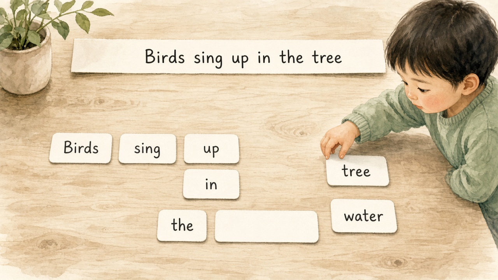

# 第 1 章 语言模型

## 1.1 语言模型建模

我们看下面的幼儿游戏：桌上散落着单词卡片，试着拼成一句完整的话。

真实的语言模型做的事情是一样的：看着已经摆好的卡片，猜下一张该是什么。这里的**语言**可以是半句话，也可以是指令，对话或一段材料，等价桌上再多几张牌，甚至多一个真实的苹果，但是玩法不变，仍是接着猜选下一项。

在历史上还有机器翻译，语音识别里的专用语言模型等形态。但就当前主流对话与通用助手产品而言，比如OpenAI 的 GPT 系列，Anthropic 的 Claude，Google 的 Gemini，xAI 的 Grok，月之暗面的 Kimi，阿里的 Qwen，以及最新的Meta的 Muse 等同一档位的通用大模型，对外提供的文本生成能力，本质上都是**大规模自回归语言模型**， 他们从左到右猜下一个词，再一步步取样成文本。

## 1.2 编解码

针对文本建模任务，依据模块组合与序列可见范围，分成三类基础结构

**Encoder（编码器）** 整段输入同时可见，每个位置可以融合左右上下文。典型任务是理解与表示：分类，检索向量，填空式预训练（如 BERT 一类的掩码语言建模），擅长给已有文本打标签或抽特征。

**Decoder（解码器）** 生成位置 \(t\) 时，只允许看见位置 \(1,\ldots,t\)（训练时用因果掩码实现）。输出是对下一个 token 的分布，逐步取样即可成文。今天的主流聊天模型，主体就是一层层堆起来的 decoder。

**Encoder–Decoder** 把两者接起来：encoder 先读完整段源文本（可双向），decoder 再自回归地写出目标序列，并通过 cross-attention 查阅 encoder 的表示，像机器翻译，经典 seq2seq，T5 一类 text-to-text 模型，当源与目标角色清晰时很合适。

刚才提到的**自回归**和**编解码**这是两个维度的概念，**自回归**指的是：整段文本的概率怎么算，生成时是不是写出一个 token 再写下一个。**编解码** 指的是：网络里每个位置允许看见哪些上下文，要不要分先读源文，再写目标。

> 思考一下，如果只堆 decoder，每步只看左边的模型，训练目标几乎总是 next-token，因而就是自回归的。只堆 encoder，左右都看的模型，预训练常常是挖空填词（如 BERT），并不按从左到右生成整段回复。Encoder–Decoder 则是encoder 读完源文 + decoder 自回归写目标，翻译上常用。

今天的decoder-only逐渐统一了自然语言任务，并且建立了成熟的训练和推理生态。

## 1.3 自回归

自回归（autoregressive）语言模型把联合分布写成历史条件概率的乘积：

\[
p(x_1,\ldots,x_n)=\prod_{t=1}^{n}p_\theta(x_t\mid x_1,\ldots,x_{t-1})
\]

\(\prod_{t=1}^{n}\) 就是从 \(t=1\) 乘到 \(t=n\)。以1.1的游戏为例，整句话拆成六个 token （真实场景token不是真的完全对应一个单词）：

\[
x_1=\mathrm{Birds},\;
x_2=\mathrm{sing},\;
x_3=\mathrm{up},\;
x_4=\mathrm{in},\;
x_5=\mathrm{the},\;
x_6=\mathrm{tree}.
\]

\[
\begin{aligned}
p(x_1,\ldots,x_6)
&=
p_\theta(\mathrm{Birds}) \\
&\quad\cdot\, p_\theta(\mathrm{sing}\mid \mathrm{Birds}) \\
&\quad\cdot\, p_\theta(\mathrm{up}\mid \mathrm{Birds},\,\mathrm{sing}) \\
&\quad\cdot\, p_\theta(\mathrm{in}\mid \mathrm{Birds},\,\mathrm{sing},\,\mathrm{up}) \\
&\quad\cdot\, p_\theta(\mathrm{the}\mid \mathrm{Birds},\,\mathrm{sing},\,\mathrm{up},\,\mathrm{in}) \\
&\quad\cdot\, p_\theta(\mathrm{tree}\mid \mathrm{Birds},\,\mathrm{sing},\,\mathrm{up},\,\mathrm{in},\,\mathrm{the}).
\end{aligned}
\]

真实生成时每一步按 \(p(x_t\mid x_{<t})\) 取出一个 token，拼回前缀再猜下一步。第一项没有前文（实现上常有特殊起始符，或直接从用户文本算起）；而输出长度不固定，通常由取样与停止条件决定。

> 训练最大化的，正是语料里这些句子的联合概率。实现上改成最大化对数 \(\sum_t\log p_\theta(x_t\mid x_{<t})\)（也就是逐步交叉熵），和最大化联合概率是同一件事，只是乘法变成更好算的加法。

与之对照，掩码语言建模在部分位置挖空，用双向上下文指导做完形填空：训练信号密，但没能构成一直向右的推理循环。encoder–decoder 在目标侧是自回归的，但条件里多了整段源文的编码。

自回归带来两个贯穿后文的后果：

1. 推理：自回归是串行，上一步输出作为下一步输入，无法一次性生成全部 token。
2. 训练：文本是现成完整序列，所有位置的目标 token 全部已知，可以一次性前向传播，可以并行计算所有位置的 next-token 损失，不用串行。

## 1.4 数据流

我们再看一下完整的数据流，包括前后两个处理。

### 流入：字符串 → token ID

模型不能直接读取原始文本字符串，需要先经过分词器（tokenizer）处理：把文本拆成若干子词单元，再转换成一串整数编号。
**词表**，就是模型预先定义好的全部子词与整数 ID 的对照表。
处理完成后的输入张量形状一般为\([B,n]\)，B是批次大小，n是序列 token 数量。

文本切分的单元越细碎，同一段文字对应的 token 数量n就越大，后续注意力计算和 KV 缓存的开销也随之上升。词表规模越大，嵌入层与最后的输出分类层参数量就越多。另外，中文，英文，代码，数字，分词之后得到的 token 密度并不相同。

### 主干：ID → 隐状态 → 词表上的得分

ID 查表得到向量后，进入多层 decoder 堆叠（第 2 章详解）。对当前序列，模型在每个位置（推理阶段仅关注最新位置）输出词表大小V维的 logits，再经过 softmax 得到条件分布 \(p(x_t\mid x_{<t})\) 。训练时，输入序列与目标标签错位一位，依靠因果掩码，一次性并行计算所有位置的交叉熵损失；推理生成时，只取序列最后一个位置的概率分布，用来采样下一个 token

### 流出：分布 → 一个 token → 写回前缀

流出侧把概率变成符号：按某种解码策略从 \(p(\cdot\mid x_{<t})\) 中选出一个 ID（贪心取最大，或温度 / top-\(p\) 等随机取样），解码回文本片段，并追加到前缀上，进入下一轮前向。

---

## 核心问答

**Q1：自回归和Decoder-only是一个意思么？**
不是。自回归指联合分布按从左到右因式分解，以及生成时逐步取样。Decoder-only 是一种网络形态（因果可见范围，无 encoder）。Encoder–Decoder 在目标侧通常也是自回归的；Encoder-only 预训练则常常不是 next-token 自回归。

**Q2：当前自回归大模型怎么做机器翻译？并没有单独的翻译头啊。**
没有。翻译被收成同一种条件生成：把源文与指令拼进前缀（例如「将下面一段译成英文：……」或多轮里的用户句），模型仍按 \(p(x_t\mid x_{<t})\) 逐步写出译文 token。源文不走经典 Encoder–Decoder 里那条独立的双向 encoder，而是作为已经写在左边的上下文，靠因果注意力被后面的生成位置读取。

能力来自预训练与指令数据里大量的双语 / 翻译示范

**Q3：为什么现在对话模型多为 Decoder-only，而不是 Encoder–Decoder？**
生成任务与因果分解天然一致；结构在扩展规模，实现 KV 缓存与并行切分上更干净。Encoder–Decoder 在源–目标不对称时仍有应用（如经典翻译），但不是当前通用对话权重的主流默认。

**Q4：训练时已经能一次前向算整句，为什么推理还要一个 token 一个 token 来？**

训练**没有**「先走到 \(a\)，再走到 \(b\)，……」的串行时间步。语料里整段 \(x_1,\ldots,x_5=a,b,c,d,e\) 事先已知，一次把完整序列送进模型；因果掩码只禁止每个位置注意右边。一次前向并行得到各位置的 logits，再与错位后的标签算交叉熵（通常取平均）：

| 位置上的输入上下文（掩码后可见） | 预测目标 |
|---|---|
| \(a\) | \(b\) |
| \(a,b\) | \(c\) |
| \(a,b,c\) | \(d\) |
| \(a,b,c,d\) | \(e\) |
| \(a,b,c,d,e\) | 结束符等 |

关键在于：位置 4 的上下文 \(a,b,c,d\) **不是逐步生成出来的**，而是数据里的真值直接铺进输入；\(e\) 始终在序列里，只是掩码不让该位置读到它。这叫 teacher forcing：下一位置的输入永远用真值 token，不用模型自己刚采出的符号——因此各位置的预测可以并行，共享同一套权重。

推理时只有 prompt（例如只有 \(a\)），\(b,c,\ldots\) 尚不存在。必须取样得到 \(b\)，才能把 \(a,b\) 当作下一步前缀；串行来自「下一步输入依赖上一步取样」，不是实现偷懒。

对照：训练像一次发多道填空，答案已印在卷子上，规则是做第 \(k\) 题时不许看右边；推理则是只给题干开头，写完一个字才能写下一个。掩码实现见第 2 章；生成阶段的 Prefill / Decode 见第 4 章。

