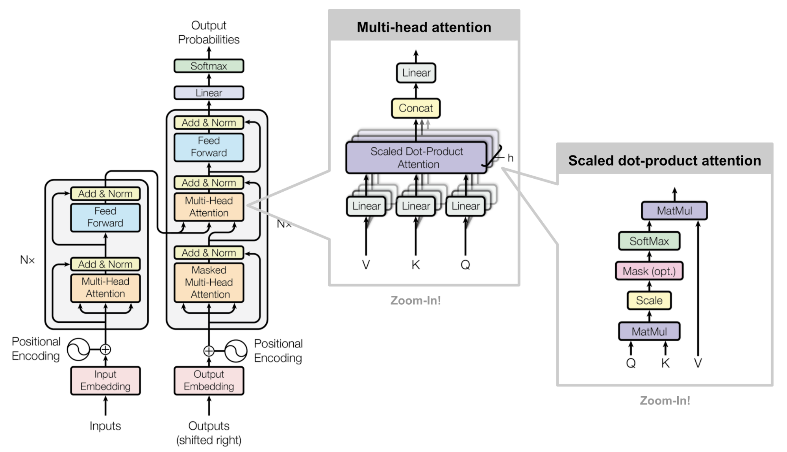

# 第 2 章 核心组件

## 2.1 QKV 与缩放点积注意力

### 例子：询问尺码

一个顾客买衣服问尺码的场景。顾客身高 170、体重 60。货架上有三张吊牌：

| 尺码 | 适合区间（用来比对） | 结论（对上后给出） |
|---|---|---|
| S | 155–165 cm / 45–55 kg | 穿 S |
| M | 165–175 cm / 55–65 kg | 穿 M |
| L | 175–185 cm / 65–75 kg | 穿 L |

三列分别对应三个角色：

- **Query \(q\)**：顾客拿来比对的条件——自己的 170 / 60。
- **Key \(k\)**：每张吊牌上的适合区间。注意KV区别 这里只回答合不合身，不回答该报哪个码。
- **Value \(v\)**：对上之后交出去的结论：M

吊牌常印成「M：165–175 cm / 55–65 kg」。

### 投影矩阵

序列里每个位置都有隐藏状态 \(x\in\mathbb R^{d}\)。注意力不直接拿原始 \(x\) 去比、去取，而是乘三个可学习矩阵：

\[
q=xW_Q,\qquad k=xW_K,\qquad v=xW_V
\]

其中 \(W_Q,W_K,W_V\in\mathbb R^{d\times d_h}\)。

- **\(W_K\)**：把该位置编成「挂在门口的标签」，方便被点积比对（尺码例子里的适合区间）。
- **\(W_V\)**：把同一位置编成「对上之后交出去的内容」（尺码例子里的「穿 M」）。
- **\(W_Q\)**：把**当前**位置编成「我带着什么条件去比」。它不是因为后面 K、V 维数是 \(d_h\) 才临时加的。点积 \(q^\top k\) 要求 \(q\) 和 \(k\) 落在同一套可比的坐标里；顾客的身材描述，本来就和吊牌上的区间描述不是同一种写法，\(W_Q\) 与 \(W_K\) 各自把两边投进这个公共比对空间。即便不做降维、\(d_h=d\)，仍然需要 \(W_Q\)：当前词「带着什么问题去看别人」，和「自己被别人怎么检索」「自己被取用时交出什么」，是三种不同的线性读法。

若只有 Q 和 K：算完相似度，只知道「和哪张吊牌更像」，还没有可写入下一层的内容。把 Key 当答案不行——Key 学的是方便比对的索引（区间），不是结论（码名）。所以必须另有 Value：分数决定**看谁、看多少**，真正累加进输出的是 \(v\)。

### Softmax

点积给出三个原始分数。例如对 S / M / L 得到 \(s=(1.0,\ 4.0,\ 2.0)\)。直接用分数无法当权重（可正可负、也不归一）。softmax 做两件事：把分数变成非负，且**一行加起来等于 1**：

\[
\alpha_j=\frac{e^{s_j}}{\sum_{j'}e^{s_{j'}}}
\]

上例近似 \(\alpha\approx(0.04,\ 0.84,\ 0.12)\)。注意力输出是

\[
o=\alpha_S\,v_S+\alpha_M\,v_M+\alpha_L\,v_L
\]

也就是：约 84% 取自「穿 M」，约 12% 取自「穿 L」，S 几乎不取。顾客落在 M 与 L 边界附近时，不必硬切成唯一一票——这就是 soft attention。权重 \(\alpha\) 随 \(W_Q,W_K\) 训练，所以「该看谁」本身是学出来的。

再看一遍Attention公式：

\[
\operatorname{Attention}(Q,K,V)
=\operatorname{softmax}\!\left(
\frac{QK^\top}{\sqrt{d_h}}+M
\right)V
\]

\(X\in\mathbb R^{n\times d}\)，单个头里 \(Q,K,V\in\mathbb R^{n\times d_h}\)，\(QK^\top\) 是 \(n\times n\) 分数表：第 \(i\) 行、第 \(j\) 列是「位置 \(i\) 对位置 \(j\) 的原始分数」。语言模型从左往右生成，算位置 \(i\) 时还不知道右边的词；若不加限制，位置 \(i\) 会直接去看 \(j>i\) 的 Key/Value，等于偷看尚未出现的 token。因果掩码 \(M\) 在 softmax 之前把这些 \(j>i\) 的格子写成 \(-\infty\)（分数表的严格上三角），softmax 后对应权重变成 0，于是每个位置只能看自己和左边。细节见 §2.3。softmax 沿每一行做：第 \(i\) 行就是位置 \(i\) 对各个 Value 的取用比例。

再乘 \(1/\sqrt{d_h}\)。维度一高，随机向量点积容易偏大，softmax 会又尖又硬，梯度不好传。除以 \(\sqrt{d_h}\) 把分数拉回合适范围。**这是全书第一次碰到数值稳定问题**，第 5 章的 QK-Norm 是它在大规模训练里的后续。

## 2.2 多头

§2.1 里一个头：每个位置得到 \(q,k,v\in\mathbb R^{d_h}\)，再做一张 \(n\times n\) 分数表。多头是：**同一套隐藏状态，并行做 \(h\) 次这样的注意力**，每次用自己的一套 \(q,k,v\)（维数仍是 \(d_h\)），最后把 \(h\) 个头的输出在特征维上拼起来。约定总宽不变：

\[
d=h\,d_h.
\]

例如 \(d=512\)、\(h=8\)，则 \(d_h=64\)；今天常见 \(d_h=128\)，\(h=d/128\)。

### 张量上怎么拆

输入 \(X\in\mathbb R^{n\times d}\)。实现里通常先做一次大投影，再按最后一维切开，而不是先把 \(x\) 切成 \(h\) 段再分别投影：

\[
Q_{\text{all}}=XW_Q,\quad
K_{\text{all}}=XW_K,\quad
V_{\text{all}}=XW_V,
\qquad
W_Q,W_K,W_V\in\mathbb R^{d\times (h d_h)}=\mathbb R^{d\times d}.
\]

此时 \(Q_{\text{all}},K_{\text{all}},V_{\text{all}}\in\mathbb R^{n\times d}\)。把最后一维看成 \(h\) 段、每段长 \(d_h\)，reshape 成

\[
Q,K,V\in\mathbb R^{n\times h\times d_h}.
\]

位置 \(i\)、头 \(t\) 上的三个向量就是

\[
q_i^{(t)},\ k_i^{(t)},\ v_i^{(t)}\ \in\mathbb R^{d_h},
\qquad t=0,\ldots,h-1.
\]

等价说法：第 \(t\) 个头有自己的 \(W_Q^{(t)},W_K^{(t)},W_V^{(t)}\in\mathbb R^{d\times d_h}\)，大矩阵 \(W_Q\) 只是把这 \(h\) 块横着拼成 \(d\times d\)。因此每个头的投影权重分开学；reshape 切开的是投影之后的 \(h\) 段坐标。

用 \(n=4\)、\(d=8\)、\(h=2\)、\(d_h=4\) 看一眼形状（数字随意）：

| 步骤 | 形状 | 含义 |
|---|---|---|
| \(X\) | \([4,8]\) | 4 个位置，每位置 8 维 |
| \(Q_{\text{all}}=XW_Q\) | \([4,8]\) | 一次投影出全部头的 Q |
| reshape | \([4,2,4]\) | 头 0 占前 4 维，头 1 占后 4 维 |
| 头 0 的 \(Q^{(0)}\) | \([4,4]\) | 只拿 \(Q[:,0,:]\) |
| 头 1 的 \(Q^{(1)}\) | \([4,4]\) | 只拿 \(Q[:,1,:]\) |

\(K,V\) 同样拆法。

### 每个头各自算完注意力

头 \(t\) 内部与 §2.1 完全相同：用该头的 \(Q^{(t)},K^{(t)},V^{(t)}\in\mathbb R^{n\times d_h}\) 算

\[
\operatorname{head}_t
=\operatorname{softmax}\!\left(
\frac{Q^{(t)}(K^{(t)})^\top}{\sqrt{d_h}}+M
\right)V^{(t)}
\in\mathbb R^{n\times d_h}.
\]

\(h\) 个头各有一张自己的 \(n\times n\) 分数表，互不共享注意力权重。头 0 可以主要对齐某类依赖，头 1 对齐另一类；这是多头的目的，不是把同一次 softmax 重复 \(h\) 遍。

### 拼回去

每个位置上，把 \(h\) 个头的 \(d_h\) 维输出在特征维首尾相接，得到 \(d\) 维，再乘输出投影 \(W_O\in\mathbb R^{d\times d}\)：

\[
\operatorname{MHA}(X)
=\operatorname{Concat}(\operatorname{head}_1,\ldots,\operatorname{head}_h)\,W_O.
\]

接上例：两个 \(\operatorname{head}_t\) 各是 \([4,4]\)，Concat 得 \([4,8]\)，乘 \(W_O\) 仍是 \([4,8]\)，与 \(X\) 同形，才能和残差相加。

总隐藏维 \(d=h d_h\) 固定时，多头与「单头且 \(d_h=d\)」的主阶 FLOPs 同阶：都是在总宽 \(d\) 上做投影和 \(n\times n\) 注意力，换来的是 \(h\) 套独立的匹配。现代模型常取 `head_dim=128`（也有 64、256）；由效果、RoPE 维数和 kernel 效率共同决定，不是必须遵守的定律。第 7 章会再改「KV 头数是否等于 Query 头数」；本章先按 \(n_{\mathrm{kv}}=h\) 理解。

## 2.3 因果掩码

\(QK^\top\) 得到 \(n\times n\) 分数表后，在进 softmax 之前加上掩码 \(M\)：凡是「查询位置 \(i\)、被看位置 \(j\)」且 \(j>i\) 的格子（严格上三角），一律写成 \(-\infty\)。softmax 里 \(e^{-\infty}=0\)，这些位置的权重就变成 0——位置 \(i\) 看不见右边还没“轮到”的词。

**训练时整句一次前向**，说的是：像 `put money in the bank` 这样整句已经摆在桌上，五个位置的 Q、K、V 和注意力在一次矩阵乘法里**一起算完**（并行），不是一个词算完再算下一个。但因果掩码保证信息仍只能从左往右流。每个位置 \(i\) 的输出用来预测**下一个**词 \(x_{i+1}\)：

| 当前位置（Query） | 允许看见的词 | 要预测的下一个词 |
|---|---|---|
| `put` | `put` | `money` |
| `money` | `put`, `money` | `in` |
| `in` | `put`, `money`, `in` | `the` |
| `the` | `put`, `money`, `in`, `the` | `bank` |
| `bank` | 整句五个词 | （句后再接什么，如结束符） |

所以：预测 `money` 时只看 `put`；预测 `bank` 时，站在 `the` 上，对前面四个词的 Value 做加权混合——不是站在 `bank` 上去“生成 bank”（那时 `bank` 已是输入，损失监督的是它后面的词）。

这不需要「前面所有词的缓存」。训练时整句输入已知，五个位置的 K、V 在这一次前向里一次性算成整块张量，用因果掩码做完 \(n\times n\) 注意力就结束；没有跨步累加的 KV Cache。KV Cache 是**推理**用的：每步只算新词的 K/V，把历史 K/V 存下来复用，避免每生成一个词就重算整段历史（第 4 章）。

推理时没有整句可并行：必须先写出 `put`，再据此采出 `money`，再采 `in`……下一步的输入依赖上一步刚写出的词，所以只能串行。

**这条裂缝贯穿全书**：第 4 章量化它的代价，第 15 章（投机解码）试图弥合它。

## 2.4 FFN

注意力解决的是：**词和词之间怎么交换信息**（谁看谁、看多少）。交换完之后，每个位置手里多了一包混合过的内容，还要在**本位置上**再加工一遍——这就是 FFN（feed-forward network，逐位置前馈）。

可以对照前面的尺码例子：注意力相当于按身材去各吊牌取内容；取回来之后，还要在柜台本地把「84% 的 M + 12% 的 L」整理成一个统一表示，好交给下一层继续用。这一步**不再问别的位置**，每个 token 各算各的。

若没有 FFN，一层里对 Value 的混合基本是加权求和（再加投影），表达能力偏「线性拼装」。FFN 在中间插入非线性，并通常先把维度抬高再压回来，给每个位置更大的变换空间。经验上，每层大部分参数也在这里（标准设定约占总参数的三分之二），所以后面第 9 章做混合专家，优先稀疏的也是 FFN。

对**单个**位置的向量 \(x\in\mathbb R^{d}\)（\(d\) 是隐藏维），普通两层 FFN 是：

\[
\operatorname{FFN}(x)=W_2\,\sigma(W_1x)
\]

| 符号 | 含义 |
|---|---|
| \(x\) | 当前这个 token 的 \(d\) 维向量 |
| \(W_1\in\mathbb R^{d_{\mathrm{ff}}\times d}\) | 升维：从 \(d\) 投到更大的中间维 \(d_{\mathrm{ff}}\)（常见 \(d_{\mathrm{ff}}=4d\)） |
| \(\sigma\) | 逐元素非线性（原版用 ReLU；现代多用 GELU / SwiGLU 等） |
| \(W_2\in\mathbb R^{d\times d_{\mathrm{ff}}}\) | 降维：再投回 \(d\)，好和后面的残差相加 |

整句有 \(n\) 个 token 时，把同一套 \(W_1,W_2\) **独立地**套在每一个位置上：位置之间在这一步不通信。通信已经在注意力里做完了。

不要把「知识只存在 FFN」当成事实——嵌入、注意力、FFN 和层间组合里都有；能确定的是 FFN 参数量大、且负责逐位置非线性加工。

## 2.5 残差

光有注意力和 FFN，还不能把层叠得很深。子层若直接用输出**替换**输入，几十层叠下去，梯度很难传回浅层——CNN 里用 skip connection 解决的就是这类问题。

Transformer 里同一招叫**残差连接**：记子层为 \(F\)（可以是注意力，也可以是 FFN），主干写成

\[
x \;\mapsto\; x+F(x)
\]

而不是 \(x\mapsto F(x)\)。子层只学习对原表示的**增量**；即便某一支暂时学得差，\(x\) 还在，下一层还能接着用。反向时梯度多了一条绕过 \(F\) 的恒等通路，深层才训得动。

残差要求 \(F(x)\) 与 \(x\) 形状相同，所以 FFN 最后要投回 \(d\) 维，注意力输出投影也要投回 \(d\) 维。

## 2.6 LayerNorm

残差让梯度有路可走，但不保证路上的数别炸。层数一多，激活的均值和方差容易漂，训练中途 loss 飞掉很常见。

**LayerNorm** 对每个位置的 \(d\) 维向量单独做：减均值、除标准差，再乘可学习增益（可加偏置）：

\[
\operatorname{LN}(x)
=g\odot\frac{x-\mu}{\sqrt{\sigma^2+\epsilon}}+b
\]

它把向量尺度拉回稳定区间，再送进（或送出）子层。与 BatchNorm 不同：统计量沿**特征维**算，不跨 batch、也不跨序列长度，所以变长序列、小 batch 也能用——序列模型里它比 BatchNorm 合适。

这一章先用 LayerNorm 把模型跑起来。第 5 章会把它简化成 RMSNorm（去掉减均值和 bias），那是放大之后的配方，不是「跑起来」的前提。

## 2.7 Post-LN

到这里零件齐了四样：注意力、FFN、残差、LayerNorm。还差一步：**归一化放在残差的哪一侧**。

2017 年原版把 Norm 放在残差**相加之后**，称为 Post-LN（post-normalization）：

\[
H=\operatorname{LN}\!\big(X+\operatorname{Attention}(X)\big),
\qquad
Y=\operatorname{LN}\!\big(H+\operatorname{FFN}(H)\big)
\]

读法：先算子层，与留下的 \(X\)（或 \(H\)）相加，再 LayerNorm。\(X,H,Y\in\mathbb R^{n\times d}\) 是整段序列的隐藏状态。一层里两段残差——先交换信息（注意力），再本位置加工（FFN）——每段外面都套同样的「加完再 Norm」。

小规模上 Post-LN + LayerNorm 能训、能生成，这一章先按它把模型跑起来。层数堆到三十多层时它会难训：梯度回传要穿过每层的 Norm，尺度容易失衡。第 5 章把 Norm 挪到子层**之前**（Pre-LN），并换成 RMSNorm——那是放大之后的事，不是把「要不要 Norm」重讲一遍。

## 2.8 绝对位置编码

注意力按内容挑词，本身**分不清先后**。不告诉它位置，「先去西湖再去灵隐」和「先去灵隐再去西湖」在它看来是同一堆词（严格说法见第 6 章的置换等变）。因果掩码只泄露「左边有几个词」这种粗线索，不够表达「相隔 3 个」和「相隔 300 个」的差别。所以顺序要**显式注入**。

2017 年的做法是**绝对位置编码**：为每个下标 \(t=0,1,\ldots\) 准备一个 \(d\) 维向量 \(\mathrm{PE}(t)\)，加在词嵌入上：

\[
h^{(0)}_t=E[x_t]+\mathrm{PE}(t)
\]

原论文用正弦 / 余弦固定公式，不同维度对应不同频率，不增加可训练参数；也可以改成一张可学习的位置嵌入表，用到哪个位置就查哪一行。两条路都是「第 \(t\) 个位置有一个专属向量」，合称绝对位置。嵌入表 \(E\) 本身、以及出 Block 之后怎样打到词表，见第 3 章；这里只要记住：**位置向量加在查表结果上**，Block 才能分清语序。

有了它，小模型就能分清语序，核心零件才算齐。但它有两处先天限制，放大和拉长之后会碰壁：

1. **绝对、不是相对**：模型要自己从「我在位置 17、对方在位置 20」里学会「相隔 3」；相对距离没有直接写进 \(q^\top k\)。
2. **长度绑在训练分布上**：可学习表在没见过的下标上没有行；正弦公式能外推，质量也常明显掉。

今天开源稠密模型几乎不再把绝对位置加在嵌入上，而是改成在注意力里旋转 Q/K（RoPE）。在第6再详细介绍。

---

## 核心问答

**Q1：为什么要除以 √d_h，不是别的数？**
d_h 维独立随机向量点积的方差正比于 d_h，除以 √d_h 恰好把方差拉回 1 量级，使 softmax 工作在梯度健康的区间。这是方差分析给出的自然选择，不是调出来的超参。

**Q2：多头会让模型变慢吗？**
基本不会。多头是把 d 维切成 h 份分别算，总 FLOPs 与单头相同，只多了一次 reshape 和最后的输出投影。代价在实现复杂度和访存模式上，不在算力。

**Q3：FFN 为什么占了大部分参数？**
标准 FFN 把 d 升到 4d 再降回来，参数量约 8d²；注意力四个投影矩阵合计约 4d²。所以 FFN 约占每层的三分之二。记住这个比例，第 9 章做混合专家时优先动 FFN，就顺理成章了。

**Q4：残差和 LayerNorm 能不能只留一个？**
浅网络有时能凑合。层数一多，两边都要：残差解决「梯度有路可走」，LayerNorm 解决「路上的数值别炸」。只留残差，尺度仍可能漂到训崩；只留 Norm、没有残差，深栈同样难训。两样分工不同，都是跑起来的要素。

**Q5：绝对位置和后面要讲的 RoPE 是什么关系？**
绝对位置加在嵌入上，让小模型能分清语序，是这一章「能跑」的答案。RoPE 改在注意力里旋转 Q/K，把相对距离直接写进 \(q^\top k\)，是把模型做深、做长之后的主流替换（第 6 章）。先会加，再理解为什么换。
