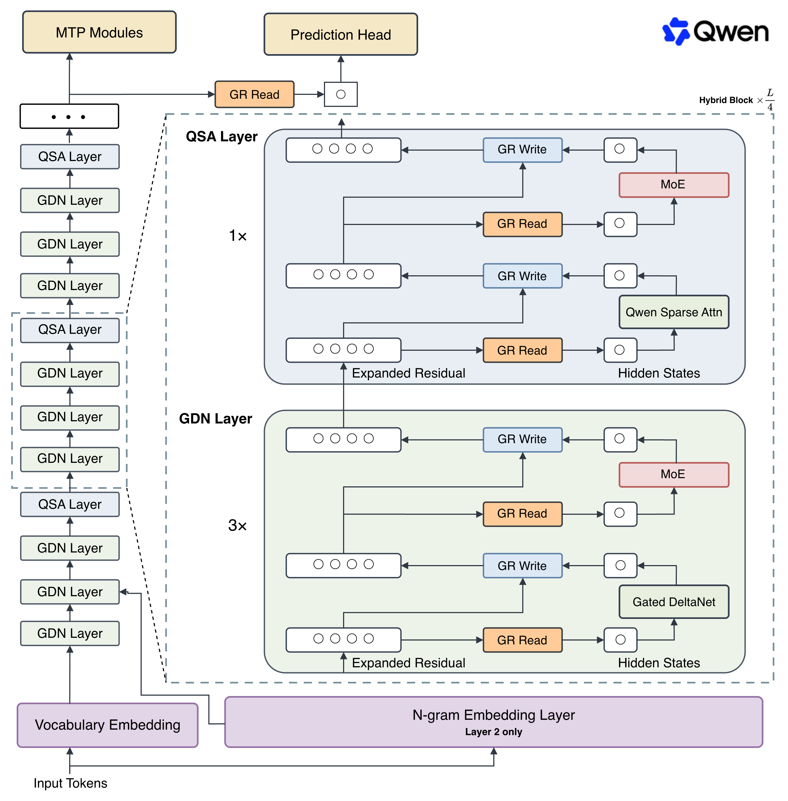

# 第 16 章 Qwen架构解析



## 16.1 总体结构

一页图讲完。48 层，按**每 4 层一组**的模式堆叠，每组是 **3 层 Gated DeltaNet + 1 层 Qwen Sparse Attention**，每个注意力/线性层后面都跟一个 MoE。官方模型卡把这个布局写成：

```
12 × ( 3 × (Gated DeltaNet → MoE) → 1 × (Qwen Sparse Attention → MoE) )
```

主干参数 125B，每 token 激活 6B；另外挂了一张 51B 的 n-gram 嵌入表和一个 4B 的 MTP 模块。隐藏维 2560，词表 248320（已 padding），原生上下文 262144，可扩展到 1,000,000。

读这张图的正确顺序，也是本书的顺序：
- 它是 **decoder-only**（第 2 章）
- 用现代稠密配方：RMSNorm、SwiGLU、RoPE、QK-Norm（第 5、6 章）
- 注意力侧走**混合**路线（第 14 章）：多数层线性、少数层精确注意力
- FFN 侧走 **MoE**（第 9 章）
- 输出侧加 **MTP**（第 15 章）

**没有一样是这一章才出现的新东西。** 这正是前面十四章存在的意义。

唯一需要更新的认知是那 1 层"精确注意力"的内部实现：Qwen3-Next 到 Qwen3.5 这条线上它是**门控注意力**（看全部历史），到 Flash-Next 换成了 **QSA**——在门控注意力的基础上加了块级的重要性筛选，只看选中的微块（第 11 章）。**层的位置和 3:1 的比例没变，变的是层内从"看全部"改成了"看选中的块"**。这条演化线见附录 D.1。

## 16.2 GDN 层的数据流

走一遍第 12 章的公式在这里的具体形态：输入经 RMSNorm → 投影出 query / key / value 与门控信号 → 按 delta rule 更新固定状态 → 门控决定遗忘强度 → 读出并过输出投影 → 残差。

这里的头配置有点特别：**V 有 48 个头，QK 只有 16 个头，头维都是 128**。V 的头数是 QK 的三倍，意味着状态矩阵在 value 方向上更宽——**这是在固定状态的容量上下注**，因为第 12.5 节说过，线性层的天花板就是状态装得下多少。

关注三件事：**状态大小与序列长度无关**（这是它省显存的全部原因）；训练时走分块并行路径，推理时走逐 token 循环路径，两条路径必须数值等价；门控参数的初始化对训练稳定性影响很大。

## 16.3 QSA 层的数据流

这些层负责第 12.5 节说的那件 GDN 做不到的事——精确回看。它由两部分组成：
**主分支**是常规注意力（第 7 章）：**24 个 Q 头、2 个 KV 头**（即 GQA，12 个 Q 头共享一份 KV），**头维 256**，外面套输出门控。注意 **RoPE 只加在 64 维上**，头维 256 里其余 192 维不带位置信息——这是第 6 章那个"部分维度不加位置编码"的做法，目的是长度泛化。

**indexer 分支**决定"看哪些块"：它自己是一个小注意力，**MQA 结构、4 个 query 头 + 1 个共享 key 头、头维 128**。它把序列聚成微块，给每个块打分，然后选出 top-k。**预算是 512 个块或 2048 个 token**，两者相除可知主分支按约 **4 token/微块**组织。入选的 512 块在精细 attention 中展开回 2048 个 token；块级打分降低索引开销，块内展开保留局部细节。

这个结构值得停一下：**indexer 本身就是一个需要训练的小模型**。它的代价（多一份 key 缓存、多一次打分）必须小于它省下的注意力计算，否则整件事不成立。这也是第 11.4 节"可学习的检索式稀疏"落到实处的样子。

**最重要的一个推论**：注意力的长度相关项被预算**封顶**了。无论上下文是 26 万还是 100 万，每个 query 实际参与计算的 KV 只有约 2048 个 token。这是它敢开 1M 上下文的直接原因（16.7 会算这笔账）。

这里的“封顶”只指主分支的精细 attention。indexer 仍要对随上下文增长的块索引做打分或检索，KV 也仍要保存；因此单 token 成本不是严格与 \(n\) 无关，而是从“对全部 token 做高维注意力”变成“较便宜的全局索引 + 固定预算的高维精算”。

## 16.4 MoE 与路由配置

第 9 章的完整落地：**512 个专家，每 token 激活 10 个路由专家 + 1 个共享专家，专家中间维 640**，配免辅助损失的偏置调节（第 9.4 节）。

**现在用第 8 章的方法手算一遍，验证你是不是真的读懂了这个模型。**

每个专家是一个 SwiGLU FFN（三个矩阵：gate、up、down），隐藏维 2560，中间维 640：

`3 × 2560 × 640 ≈ 4.92M` 参数/专家

每层 512 个专家：

`512 × 4.92M ≈ 2.52B` 参数/层

48 层：

`48 × 2.52B ≈ 121B`

加上注意力层、嵌入和归一化，正好对上官方公布的 **125B**。**MoE 的 FFN 吃掉了这个模型 96% 以上的参数。**

再算激活的部分。每 token 走 11 个专家（10 路由 + 1 共享）：

`11 × 4.92M ≈ 54M` 参数/层 → `48 × 54M ≈ 2.6B`

加上注意力与嵌入部分，约 **6B**，与官方数字一致。

**这套算术是本章最该带走的技能。** 只要拿到 `config.json` 里那几个数，你就能独立算出总参数、激活参数和部署显存下限，不必依赖厂商的宣传口径。

## 16.5 n-gram 嵌入：一个不在本书十四章里的零件

51B 的 n-gram 嵌入表是这个模型最不常规的部分：**两千万个 bigram / trigram 条目，在第 2 层做查表注入**。由参数量反算：

\[
20{,}000{,}000\times2560
=51.2\text{B},
\]

主体就是一张“约两千万条目 × 隐藏维 2560”的大表。输入序列先形成 bigram/trigram 的离散索引，再查出与主干同维的向量，在浅层注入残差流。它不是对全文做向量检索，而是用短 n-gram ID 直接寻址，因此计算接近普通 embedding lookup。

它在解决什么问题：**给模型加参数有三条路——加层（贵）、加专家（要通信）、加嵌入表**。嵌入表是查表操作，几乎不增加计算量，而且**可以放到 CPU 内存里按需取**，对显存受限的部署特别友好。官方的说法就是"嵌入提供了一条独特的参数扩展轴"。

**怎么看待它**：这是第 10 章“记忆层”那条线（把知识挪出 FFN）的一个离散寻址变体，也是本章唯一一个正文没有专门讲过的结构。它与 product-key memory 的差别是后者按学习到的 query 做近邻检索，这里按短 n-gram 直接查表；共同点都是“用不规则访存换取几乎不增加矩阵乘的参数容量”。它是不是会被其他厂商跟进，现在还不知道——按 16.9 的态度处理即可。

## 16.6 MTP 头与推理加速链路

第 16.4 节的实现：主干之后挂 **1 层 MTP 模块，用多步方式训练**，参数量 4B。训练时提供额外的监督信号，推理时作为草稿头驱动投机解码。需要留意训练时的 loss 权重和推理时的接受率这两个数。

## 16.7 从 config 算到显存与吞吐

最后一次动用第 4 章的三个公式，这次一次性算全。

**① 权重显存（bf16）**

| 部分 | 参数量 | bf16 显存 |
|---|---|---|
| 主干（MoE 全部常驻） | 125B | 250 GB |
| n-gram 嵌入表 | 51B | 102 GB（可放 CPU） |
| MTP | 4B | 8 GB |

**MoE 的稀疏只降低计算量，不降低显存**——512 个专家全都要在显存里待着（第 9.6 节）。

**② KV 显存**

只有 12 层 QSA 产生随长度增长的缓存，36 层 GDN 只有与长度无关的固定状态。

每 token 每层：`2 (K和V) × 2 字节 × 2 个KV头 × 256 头维 = 2 KB`
全模型：`12 层 × 2 KB = 24 KB / token`

| 上下文 | KV 显存 |
|---|---|
| 262K（原生） | 约 6 GB |
| 1M（扩展后） | 约 24 GB |

对照一下：**如果 48 层全都是这种注意力，就是 96 KB/token，262K 要 25 GB。3:1 的混合直接省掉了四分之三。** 另外 indexer 还要存自己的 key（1 头 × 128 维 = 256 B/层/token，12 层约 3 KB/token），262K 下约 0.8 GB，相对主 KV 可以忽略。

**③ 每 token 计算量**

权重项：`2 × 6B ≈ 12 GFLOPs`。

长度相关项分成两部分：QSA 主分支只对约 2048 个入选 token 做高维精细注意力，这一部分由预算封顶；indexer 的候选打分/检索仍随块数增长，只是维度更小、粒度更粗。因此它消除了稠密 attention 的主要 \(O(n)\) decode 读数常数和 \(O(n^2)\) prefill 主项，但不能写成“上下文再长都完全不增加成本”。

全连接 Prefill 的平方项，在这个模型里被替换了：剩下的是近线性的索引开销与固定预算精算；最终拐点要看 QSA kernel 和 indexer 实测。

**④ 对比同等激活量的稠密模型**

一个 6B 的稠密模型，权重显存 12 GB，每 token 也是约 12 GFLOPs。

| | 6B 稠密 | Qwen3.8-Flash-Next |
|---|---|---|
| 权重显存 | 12 GB | 250 GB（约 21 倍） |
| 每 token 计算量 | ≈ 12 GFLOPs | ≈ 12 GFLOPs（持平） |
| 质量 | 6B 水平 | 远高于 6B |
| 长上下文成本 | 稠密 attention 平方增长 | 近线性索引 + 固定预算精算 |

**这就是整个模型的交易条款：拿二十倍的显存，换到接近 6B 模型的推理速度和远超 6B 的质量。** 值不值得完全取决于你的部署场景——单卡跑不动，但在有足够显存的服务集群上，它的每 token 成本极低。

算完这四行，你对这个模型的理解就超过了绝大多数只读过架构图的人。

## 16.8 对照清单：通用 vs 专属

| 模块 | 属于 | 对应章节 |
|---|---|---|
| decoder-only、因果掩码 | 全行业通用 | 第 2 章 |
| RMSNorm / SwiGLU / QK-Norm | 全行业通用 | 第 5 章 |
| RoPE、解耦/部分维度位置编码 | 通用思想 | 第 5.4、6.4 节 |
| GQA（24 Q 头 / 2 KV 头） | 全行业通用 | 第 7 章 |
| MoE、共享专家、免辅助损失路由 | 全行业通用 | 第 9 章 |
| 线性注意力 + delta + 门控 | 通用思想，GDN 是其一种实现 | 第 12 章 |
| 块稀疏 + 可学习 indexer | 通用思想，QSA 是其一种实现 | 第 11 章 |
| 混合比例 3:1 与层位安排 | 通用思想，比例是 Qwen 的选择 | 第 14 章 |
| MTP | 全行业通用（DeepSeek 亦用） | 第 15 章 |
| **QSA 只旋转 64/256 维** | **Qwen 的具体选择** | 16.3 |
| **n-gram 嵌入表（51B、层 2 注入）** | **Qwen 的具体选择** | 16.5 |
| **4 分支、瓶颈秩 320 的门控残差等变体** | **Qwen 的具体选择** | 16.9 |
| **GDN 的 48/16 头配比、专家中间维 640 等所有数字** | **Qwen 的具体选择** | 16.1–16.6 |

**这张表是第一册的最终交付物**：左边这些你带得走，右边这些下一代会变。

## 16.9 那些只在它身上出现的零件

诚实地把 Qwen 专属的部分单独列出来，不要和通用思想混在一起：门控残差（**4 个分支、瓶颈秩 320**）的具体形式、归一化的细节变体（如零中心化的 RMSNorm 权重）、n-gram 嵌入表，以及各处的初始化与缩放选择。注意 4 分支/秩 320 是**门控残差**配置，不是 n-gram 嵌入配置。

对待这些东西的正确态度：**知道它在解决什么问题（基本都是稳定性和局部语义增强），不必当成必须掌握的通用知识**。下一代模型里它们很可能就变了。

顺带说一句：这个模型被官方定位成 **Qwen4 架构的预览版**——Qwen3-Next 之于 Qwen3.5 是同样的角色。**厂商习惯用一个中等规模的模型先把新架构放出来试水**，所以这类"Next / Preview"命名的模型往往比同期的旗舰更值得读（附录 D.1）。

---

## 核心问答

**Q1：为什么 3 层 GDN 配 1 层注意力，而不是别的比例？**
因为 GDN 省得多但记不住细节，注意力准但贵，3:1 是在它们的目标场景上试出来的平衡点（第 14.2 节）。它是一个工程选择，不是理论结论——MiniMax-01 用过 7:1，Gemma 2 用过 1:1，都合理。不过到 2026 年，3:1 附近已经是几家旗舰的共同选择了（附录 D.4）。

**Q2：这个模型的 KV 显存怎么算？**
只统计 12 层 QSA，套第 4 章的公式：每 token 每层 2 KB，全模型 24 KB，262K 上下文约 6 GB。GDN 层只有与长度无关的固定状态。这是它能开超长上下文的直接原因。

**Q3：它是 MoE 模型，我需要多少显存才能跑？**
主干按**总参数**算：125B × 2 字节 = 250 GB（不是按 6B 激活参数算），再加 KV 和框架开销。n-gram 表那 102 GB 可以卸到 CPU。MoE 的稀疏只降低计算量，不降低显存需求（第 9.6 节）。

**Q4：QSA 会不会选错块，把重要信息漏掉？**
会，这是稀疏注意力固有的失效模式（第 11.5 节）——一旦某个块没被选中，它就完全不参与计算，不像线性注意力那样只是变糊。缓解手段是 indexer 和主干一起训练（让选择策略自己学好），以及总是保留最近的块。**判断一个稀疏注意力模型好不好用，要看它在"大海捞针"这类精确检索任务上的表现，不能只看困惑度**。

**Q5：GDN 层在训练和推理时是同一套代码吗？**
不是。训练走分块并行以保证效率，推理走逐 token 状态更新以保证低延迟，两条路径必须数值等价。这是实现这类模型时最容易出错的地方。

**Q6：下一代模型出来，这一章还有用吗？**
16.8 表格的左列有用，右列会过期。这也是本书把它放在最后一章而不是当成主线的原因——**你要带走的是左列，以及 16.4 那套手算参数量的方法。**
