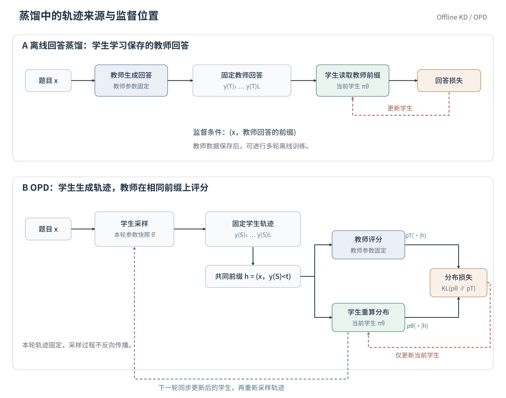

# 第 2 章 蒸馏

监督微调需要一批值得学习的回答。人工编写这批数据，质量比较容易控制，但规模和覆盖面受标注成本限制；模型越强，能够处理的任务越复杂，人工提供完整解答也越困难。因此，后训练经常借助已经训练好的模型生成监督信号，再用这些信号训练另一个模型。这种由教师模型指导学生模型的训练方法，称为知识蒸馏，Knowledge Distillation。

蒸馏早期主要服务于模型压缩，希望把大模型或多个模型组成的集成，压缩成部署成本更低的单个模型。大语言模型的后训练保留了这一用途，同时增加了能力迁移的需求：教师可能经过更充分的指令训练和强化学习，擅长推理，代码或工具使用，而学生需要学习这些行为。两者可以大小不同，也可以参数规模相近。

教师能够提供的监督有不同层次。最直接的是一段生成文本，学生按普通 SFT 学习；更细的是每个位置的下一词分布，学生对齐教师对各个候选的判断。自回归生成又带来了新的问题：训练时读取教师的回答，推理时读取学生自己的输出，两种前缀分布并不相同。同策略蒸馏 OPD 正是沿着这个问题发展出来的。要理解它，先需要讲清楚教师分布怎样进入损失，以及不同训练方式分别在什么位置比较师生。

## 2.1 蒸馏目标

设教师模型为 \(p_T\)，学生模型为 \(p_\theta\)。教师在这一阶段保持固定，学生参数 \(\theta\) 通过反向传播更新。给定相同输入，两者都输出词表上的 logits，再经过 softmax 得到下一 token 的概率。我们希望学生既学会教师最终选择的 token，也能在条件允许时学习整个分布中保留的信息。

普通交叉熵使用一个目标 token。设该 token 的编号为 \(k\)，损失为

\[
\mathcal{L}_{\mathrm{hard}}=-\log p_\theta(k)
\]

标签只指定这一个位置。求导时，所有候选都会受到 softmax 归一化的影响，但监督没有进一步说明：其他候选中，哪些也是合理表达，哪些几乎不应该出现。教师的概率分布可以提供这部分区别。

令教师对候选 \(v\) 的概率为 \(p_T(v)\)，用它作为软标签，交叉熵为

\[
\mathcal{L}_{\mathrm{soft}}
=-\sum_{v=1}^{V}p_T(v)\log p_\theta(v)
\]

\(V\) 为词表大小。每个候选都按教师概率参与损失，教师分配概率越多，它对学生的监督权重越大。对于多个合理续写，这个目标允许学生同时为它们保留概率。教师自身的不确定性和错误倾向也会被传入，因此软标签的价值仍取决于教师在当前任务上的判断。

软目标交叉熵常写成 KL 散度：

\[
D_{\mathrm{KL}}(p_T\|p_\theta)
=
\sum_vp_T(v)\log\frac{p_T(v)}{p_\theta(v)}
=
-\sum_vp_T(v)\log p_\theta(v)-H(p_T)
\]

其中 \(H(p_T)=-\sum_vp_T(v)\log p_T(v)\) 是教师分布的熵。教师固定时，熵与学生参数无关，所以最小化这条 KL 和最小化软目标交叉熵具有相同的学生梯度。KL 的写法便于说明两个分布的差异，交叉熵的写法则直接显示每个候选怎样参与监督。

对学生 logit \(z_{\theta,v}\) 求导，在温度为 1 时有

\[
\frac{\partial\mathcal{L}_{\mathrm{soft}}}
{\partial z_{\theta,v}}
=p_\theta(v)-p_T(v)
\]

如果学生给某候选的概率低于教师，梯度下降会倾向提高它的 logit；高于教师，则倾向降低。所有候选共同调整，逐渐使学生分布接近教师。这比只看“最大概率 token 是否一致”更细：师生选中了同一个词，概率分配仍可能相差很大，蒸馏损失仍会继续提供梯度。

经典蒸馏经常引入温度 \(\tau\)，对师生 logits 同时缩放：

\[
p_T^{(\tau)}(v)
=
\frac{\exp(z_{T,v}/\tau)}
{\sum_u\exp(z_{T,u}/\tau)},
\qquad
p_\theta^{(\tau)}(v)
=
\frac{\exp(z_{\theta,v}/\tau)}
{\sum_u\exp(z_{\theta,u}/\tau)}
\]

\(\tau>1\) 会使分布变平，让低概率候选之间的关系更明显。温度没有创造额外知识，只是改变已有概率差异在损失中的呈现。温度太高，无关候选也会得到较多权重；学生容量有限时，模仿这些细节可能挤占对重要候选的拟合能力。

若还保留真实标签，可以把硬目标和软目标组合起来：

\[
\mathcal{L}
=(1-\alpha)\mathcal{L}_{\mathrm{hard}}
+\alpha\tau^2
D_{\mathrm{KL}}\!\left(
p_T^{(\tau)}\|p_\theta^{(\tau)}
\right)
\]

\(\alpha\) 决定教师监督所占比例。乘 \(\tau^2\) 是经典配方中的梯度尺度补偿：温度改变 softmax 的导数和概率差，较高温度下梯度会缩小，这个系数用来使软目标与硬目标的相对尺度更易控制。它并不意味着所有大模型蒸馏都应使用高温；不少语言模型后训练直接在温度为 1 的分布上比较。

还要区分这里的“蒸馏温度”和生成回答时的“采样温度”。前者改变用于计算损失的分布，后者改变生成轨迹的行为分布。两个设置可以相同，也可以不同。分析一个蒸馏方法时，需要分别查看生成配置和损失定义。

## 2.2 语言模型蒸馏

对于自回归语言模型，监督对象从一个分类结果变成了整个回答。给定提示 \(x\)，回答为 \(y=(y_1,\ldots,y_L)\)，每个位置的前缀记为 \(h_t=(x,y_{<t})\)，于是

\[
p_\theta(y\mid x)
=\prod_{t=1}^{L}p_\theta(y_t\mid h_t),
\qquad
\log p_\theta(y\mid x)
=\sum_{t=1}^{L}\log p_\theta(y_t\mid h_t)
\]

蒸馏可以使用整条回答，也可以在每个 \(h_t\) 上比较分布。两种做法需要的教师访问能力不同，训练成本和监督密度也不同。

最常见的起点是回答蒸馏，也称序列级蒸馏。先为一批提示生成教师回答，经过筛选后构成数据集 \(D_T\)，学生使用交叉熵学习：

\[
\mathcal{L}_{\mathrm{seq}}
=
-\mathbb{E}_{(x,y)\sim D_T}
\left[
\sum_{t=1}^{L}\log p_\theta(y_t\mid x,y_{<t})
\right]
\]

实际批次仍需按有效回答位置归一化，排除 prompt 与 padding。训练过程与上一章的 SFT 相同，变化在于目标回答由教师生成。教师可以是远程服务，也可以是本地模型；只要能够获得文本，就能构造这种数据，学生和教师也不必使用相同 tokenizer。

这里的“序列级”指保存并学习整条教师输出，损失仍然逐 token 计算。训练时回答全文已知，各位置一次前向并行预测；因果掩码保证位置 \(t\) 只读取它左侧的内容。教师在数据准备阶段完成生成，学生训练时可以不再加载教师。

如果教师回答确实从 \(p_T(y\mid x)\) 中采样，那么对大量教师回答做最大似然，在总体期望上相当于最小化教师到学生的序列正向 KL，其中教师熵与学生参数无关。实际数据往往经过温度采样，候选筛选和人工修改，其分布已经发生变化，学生学习的是最终保留下来的数据分布。贪心生成也只选取教师偏好的单条路径，不能代表完整教师分布。

推理模型让回答蒸馏的重要性进一步增加。教师可以在回答中生成中间计算，检查与修正，学生通过学习这些轨迹获得相应的推理行为。DeepSeek-R1 的公开蒸馏模型就采用了这样的路线：整理推理数据，在已有 Qwen，Llama 基座上进行监督微调。蒸馏模型的名称反映了教师数据来源，并不意味着训练一定使用了教师 logits。

推理轨迹的质量比长度更重要。教师答案正确，中间过程仍可能包含错误；教师使用了学生输入中没有的资料，学生也可能只能记住训练题。适合迁移的轨迹，需要在学生可见条件下能够成立，且其中的计算方式有机会推广到其他问题。较长轨迹增加了监督位置，也增加了生成，训练和后续推理成本，不能把长度本身当作能力提升的依据。

另一种做法是在固定前缀上蒸馏下一词分布：

\[
\mathcal{L}_{\mathrm{token}}
=
\mathbb{E}_{(x,y)\sim D}
\left[
\sum_{t=1}^{L}
D_{\mathrm{KL}}\!\left(
p_T(\cdot\mid h_t)
\|p_\theta(\cdot\mid h_t)
\right)
\right]
\]

这里 \(D\) 提供要读取的序列，序列可以来自真实数据，教师或学生。教师和学生读取同一条序列，在相同前缀处输出分布，再计算 KL。因此，逐 token 蒸馏比回答蒸馏保留更多教师信息：即使实际序列在位置 \(t\) 只写了一个 token，教师对其余候选的判断也参与训练。

前缀必须一致。两模型分别自由生成自己的回答，再把第 \(t\) 个 logits 对齐，并不构成这个目标，因为两者此前已经读到了不同内容。通常的实现是先固定一条序列，再让师生分别进行 teacher-forcing 前向，获得与同一组前缀对应的 logits。

词表也必须对应。即使两个词表大小相同，候选编号仍可能表示不同片段。tokenizer 不同还会导致位置边界不同，不能直接逐元素计算 KL。文本回答可以重新分词，概率分布则需要共同的候选空间，或者专门设计跨分词器对齐方法。

蒸馏还可以约束中间表示。教师某层隐藏状态为 \(h_T\)，学生为 \(h_S\)，宽度不同可先用投影 \(P\) 对齐：

\[
\mathcal{L}_{\mathrm{hidden}}=\|P(h_S)-h_T\|_2^2
\]

这类方法还需选择层间对应，并与输出目标共同训练。师生架构接近时，内部特征可以提供有用监督；架构相差较大时，强行要求中间状态一致，可能限制学生形成适合自身结构的表示。对于只开放文本接口的教师，这条路线也无法直接采用。

当前大模型中的蒸馏因而存在几种并行用途。预训练或压缩阶段可以利用大模型的分布训练较小模型；指令与推理后训练大量使用筛选后的生成数据；能够访问教师概率时，则可以进一步做分布蒸馏。选择取决于教师接口，学生基础，任务要求和计算预算。它们共享教师指导学生的思路，实际优化的目标却需要分别写清。

## 2.3 KL 的方向与前缀分布

上一节使用了正向 KL，即 \(D_{\mathrm{KL}}(p_T\|p_\theta)\)。KL 不对称，把教师与学生的位置交换，就得到反向 KL：

\[
D_{\mathrm{KL}}(p_\theta\|p_T)
=
\sum_vp_\theta(v)\log\frac{p_\theta(v)}{p_T(v)}
\]

两者在学生能够完整表示教师时，都以师生分布相同为最小值；学生容量不足，无法同时拟合教师的所有行为时，方向就会影响最终保留哪些概率。

正向 KL 用教师概率加权。教师认为重要的候选，如果学生给的概率很低，损失就会较大。因此它倾向让学生覆盖教师有较多概率质量的区域。反向 KL 用学生概率加权，更直接检查学生目前把概率放到了哪里：如果学生经常选择的候选在教师那里概率很低，惩罚会很强；学生几乎不选的候选，对这一期望的贡献也很小。

这个区别常被概括为正向 KL 更偏覆盖，反向 KL 更偏选择高概率模式。它描述的是受限模型下的拟合倾向，不能理解为反向 KL 必然只剩一种输出。学生模型容量，训练数据和其他损失仍会影响结果。

固定前缀 \(h\)，记 \(q(v)=p_\theta(v\mid h)\)，\(p(v)=p_T(v\mid h)\)。正向 KL 的梯度前面已经得到，为 \(q(v)-p(v)\)。反向 KL 对学生 logit \(z_{\theta,j}\) 的梯度则为

\[
\frac{\partial D_{\mathrm{KL}}(q\|p)}
{\partial z_{\theta,j}}
=
q(j)\left[
\log\frac{q(j)}{p(j)}
-D_{\mathrm{KL}}(q\|p)
\right]
\]

梯度同时依赖候选自身的概率比和整个分布的平均差异。各个候选的概率受归一化条件约束，改变一个 logit 会通过 softmax 影响全部候选，所以不能只按某个词的 log 概率差判断完整更新。实现反向 KL 时，需要保留这部分 softmax 导数。

不过，选择 KL 方向还没有完整定义一个语言模型蒸馏任务。我们还需要知道，在哪些前缀上比较这两个分布。可以用一个统一表达式说明：

\[
\mathcal{L}(\theta)
=
\mathbb{E}_{h\sim d}
\left[
D\!\left(
p_T(\cdot\mid h),p_\theta(\cdot\mid h)
\right)
\right]
\]

其中 \(d\) 是训练前缀的分布，\(D\) 可以取正向 KL，反向 KL 或其他分布距离。损失的内层决定同一前缀上的概率怎样匹配，外层决定学生有机会在哪些前缀上接受指导。两个选择彼此独立：使用学生前缀，并不意味着只能使用反向 KL；使用教师前缀，也并不排斥其他距离。

教师生成的回答通常较为规范。训练学生读取这些回答时，它一直处在教师提供的前缀中。推理时，学生却要读取自己刚刚采出的内容。只要某一步选择不同，后面的输入就可能逐渐离开训练时常见的区域。这个问题属于自回归训练中的分布偏移，也常与 exposure bias 一起讨论。

偏移不只来自明显错误。教师可能习惯先列条件再推导，学生先计算再补充条件；两种前缀都可能合理，却具有不同的后续需求。固定教师数据无法完整覆盖学生实际上会访问的所有状态。越长的生成，前缀差异越有机会累积，仅在教师轨迹上减小损失，未必能让学生自由生成时同样稳定。

因此，蒸馏效果不只取决于教师给出的目标有多好，也取决于这些目标是否覆盖学生需要作出决策的位置。这就引出了同策略蒸馏。

## 2.4 同策略蒸馏 OPD

On-Policy Distillation，OPD，同策略蒸馏，把学生自己的生成轨迹用于训练。给定一批提示，先让学生生成回答，再让教师读取这些回答，对学生实际经过的每个前缀提供监督。学生不必先写出与教师相同的开头，教师就在当前已经形成的上下文上指导下一步。

这里的策略就是模型根据当前前缀选择下一 token 的条件分布，连续采样得到的整段回答称为轨迹。“同策略”说的是数据来源：产生训练轨迹的应是当前学生或足够接近当前学生的近期版本。教师通常在整个阶段固定，变化的是学生参数，以及它所生成的回答。教师在这些回答上执行评分，和教师另写一份标准答案，是两种不同的工作。

图 2-1 离线回答蒸馏与 OPD 的数据来源。上半图由教师生成回答，再由学生学习；下半图由学生生成轨迹，教师与待更新学生在共同前缀上计算分布。

两条流程中，教师参数都保持固定，但它承担的工作不同。上半图需要教师逐步生成一份回答，学生随后在教师前缀上学习；下半图已经有学生产生的序列，教师读取它，对这些实际出现的前缀提供下一词分布。已知整段序列之后，教师可以并行计算各位置分布，无需另写一份标准回答。

图中下半部分展示完整分布损失的版本。本轮采样得到的 token 与前缀作为固定数据，梯度通过当前学生的分布计算，教师参数保持冻结。蓝色虚线表示下一轮把更新后的学生用于采样，使后续监督位置随学生行为变化。数据生成与参数更新因此交替进行。

设本轮用于采样的学生参数为 \(\bar\theta\)，回答 \(y\sim p_{\bar\theta}(\cdot\mid x)\)。固定这批回答后，可以让待更新学生与教师在每个前缀 \(h_t=(x,y_{<t})\) 上计算完整分布损失：

\[
\mathcal{L}_{\mathrm{OPD}}(\theta;\bar\theta)
=
\mathbb{E}_{x,\ y\sim p_{\bar\theta}}
\left[
\frac{1}{L}\sum_{t=1}^{L}
D_{\mathrm{KL}}\!\left(
p_\theta(\cdot\mid h_t)
\|p_T(\cdot\mid h_t)
\right)
\right]
\]

这里给出反向 KL 的版本。生成的 token 和前缀被视为固定数据，反向传播通过当前学生的分布进行。更新若干步后，用新学生重新生成轨迹，训练位置随之刷新。前缀分布与局部损失这样交替变化，构成了基本的同策略训练。

这个式子也指出了一个实现细节。它是固定本轮采样分布后优化的局部目标。若直接把外层改写成 \(y\sim p_\theta\)，并要求对整个期望严格求导，回答的采样概率也依赖 \(\theta\)，会额外出现轨迹分布的导数。把采样数据固定后只对逐位置损失求导，不能不加说明地宣称是完整轨迹目标的无偏梯度。

完整分布监督在每个位置检查整个词表，即使学生实际采到了某个 token，教师对其他候选的判断也会产生梯度。这样信号较密，代价是师生都要计算词表分布，并保留损失所需的中间量。另一条常见路线只使用实际采出的 token，由教师和学生对它的 log 概率差构造更新信号。

仍固定一个前缀 \(h\)，反向 KL 可以写成

\[
K(h)
=
\mathbb{E}_{a\sim q_\theta(\cdot\mid h)}
\left[
\log q_\theta(a\mid h)-\log p_T(a\mid h)
\right]
\]

其中 \(a\) 是在该位置采出的 token，\(q_\theta\) 表示学生。这个期望中的采样概率与 log 概率都依赖学生参数。对它们一起求导，再利用 \(\sum_aq_\theta(a\mid h)=1\)，得到

\[
\nabla_\theta K(h)
=
\mathbb{E}_{a\sim q_\theta}
\left[
\left(
\log q_\theta(a\mid h)-\log p_T(a\mid h)
\right)
\nabla_\theta\log q_\theta(a\mid h)
\right]
\]

于是可以定义一个局部优势信号

\[
A(h,a)
=
\log p_T(a\mid h)-\log q_\theta(a\mid h)
\]

在梯度下降中最小化 KL，等价于按这个信号加权，提高或降低学生对采样 token 的 log 概率。教师给它的概率相对更高，信号为正；教师相对更不认可它，信号为负。相比只在整条回答结束后获得一个奖励，这里每个 token 都能获得教师反馈。

需要注意，优势的数值包含学生概率，但在构造这一采样梯度估计时，要把优势视为固定权重。如果连同优势内部的学生概率一并反传，就会得到另一种梯度。用 \(\operatorname{sg}\) 表示停止梯度，单个固定前缀上的采样代理损失可写成

\[
\widehat{\mathcal{L}}
=
-\operatorname{sg}[A(h,a)]\log q_\theta(a\mid h)
\]

它产生的是上面期望梯度的一次采样估计。这里必须先有“token 是从哪个分布采出的”这个条件；从教师采样，从旧学生采样和从当前学生采样，得到的估计并不自动相同。

完整回答还涉及跨位置的影响。早期一个 token 会改变后续全部前缀，因而影响后续获得的教师反馈。若希望严格优化完整回答的反向 KL，可以定义序列目标

\[
\mathcal{K}_{\mathrm{seq}}
=
D_{\mathrm{KL}}\!\left(
q_\theta(y\mid x)\|p_T(y\mid x)
\right)
=
\mathbb{E}_{y\sim q_\theta}
\sum_{t=1}^{L}
\log\frac{q_\theta(y_t\mid h_t)}
{p_T(y_t\mid h_t)}
\]

在包含结束符，序列分布正常归一化的设定下，对负 KL 求梯度，可用从当前位置向后的累计 log 概率差信号：

\[
A_t^{\mathrm{return}}
=
\sum_{u=t}^{L}
\left[
\log p_T(y_u\mid h_u)
-\log q_\theta(y_u\mid h_u)
\right]
\]

\[
-\nabla_\theta\mathcal{K}_{\mathrm{seq}}
=
\mathbb{E}_{y\sim q_\theta}
\sum_t
A_t^{\mathrm{return}}
\nabla_\theta\log q_\theta(y_t\mid h_t)
\]

这样早期动作也会收到它对后续轨迹造成的影响。只使用当前位置的 \(A_t\)，则更强调当前位置的教师指导。两者涉及不同的信用分配，方差和优化行为也不同。实际称为 OPD 的方法既包括固定学生前缀上的分布回归，也包括利用逐 token 信号构造的策略更新，不能把它们混成一个没有差别的损失。

工程上常保存采样版本的概率 \(q_{\bar\theta}(y_t\mid h_t)\)，再用当前学生概率构造比值

\[
\rho_t(\theta)
=
\frac{q_\theta(y_t\mid h_t)}
{q_{\bar\theta}(y_t\mid h_t)}
\]

对采样时计算出的优势 \(A_t\)，可以使用 PPO 形式的裁剪代理目标：

\[
\mathcal{L}_{\mathrm{clip}}
=
-\mathbb{E}
\left[
\min\left(
\rho_t A_t,\
\operatorname{clip}(\rho_t,1-\epsilon,1+\epsilon)A_t
\right)
\right]
\]

\(\epsilon\) 限制代理目标中概率变化的获益范围。裁剪有助于控制同一批轨迹上反复更新的幅度，但已经引入了目标近似；只校正当前 token 的概率比，也没有完整校正所有历史前缀的分布。关于策略梯度，旧策略与裁剪，第 4，5 章会继续展开。在蒸馏里使用这些工具时，应同时交代优势来自教师还是终局奖励，以及是否使用额外的参考约束。

一轮 OPD 的实际计算可以顺着数据流看清。首先把学生当前权重同步到生成端，对提示进行自回归采样，保存回答，结束位置和采样版本。随后让教师读取同一条回答，取得各位置的完整分布，或取得实际生成 token 的条件 log 概率。教师评分可以对已知序列并行前向，不必再逐 token 生成新回答。训练端则重新计算当前学生概率，形成选定的分布损失或策略代理损失，只更新学生。

教师始终读取学生真正生成的前缀。学生此前出现偏差，教师也会在这个已经发生的上下文上给出下一词判断。这样的反馈有助于学习学生经常遇到的状态，却无法自动撤销先前错误。如果前缀已经把错误事实写死，教师继续这个前缀的分布也可能不适合作为修正目标。可以混入高质量教师轨迹，保留普通监督损失，或引入经过验证的修正回答，让学生同时学习稳定的正确路径和自身常见状态。

在计算资源上，OPD 比离线回答蒸馏多出了持续生成与教师评分。完整词表监督的主要压力是大输出张量及其通信，采样 token 监督减少了保存的概率数量，却仍需通过教师计算归一化概率。教师前向不能因为只保留一个 log 概率，就当然免去输出层计算。

采样设置也参与目标定义。温度和 top-p 会改变学生实际生成 token 的分布，若训练分母仍使用未经变换的原始概率，概率比就与行为分布不符。实现可以选择对应的行为概率，或者明确采用近似与校正。长回答，异步采样与多次更新还会增大策略滞后，因而通常需要控制轨迹的新鲜程度和每批更新次数。

这些条件共同决定 OPD 是否有效。它让教师监督更贴近学生推理时访问的位置，但没有省去学生的基础能力要求，也没有让教师错误消失。教师选得是否合适，学生能否利用反馈，以及目标与采样是否一致，都要通过实际训练检查。

## 2.5 蒸馏的实践与前沿

在实际的大模型训练中，蒸馏承担着几种不同的任务。最容易想到的是压缩：已经有一个能力较强的大模型，希望用更少的参数，更低的推理成本保留其中一部分能力。还有一种情况，学生的大小已经确定，但同样规模的模型在数学，代码或指令理解上表现不足，于是借助更强的教师继续训练。对于这类任务，蒸馏首先改变的是学生的能力，参数量可以保持不变。

蒸馏也可以迁移一种新的工作方式。例如，教师经过推理训练，能够在回答前进行较长的分析；学生通过学习这些轨迹，逐渐学会分解问题，检查中间结果和修正推导。工具调用的迁移则需要更完整的数据：除了用户问题和模型输出，还应保留工具定义，调用参数，执行结果以及后续处理。若只保存最后一段回答，学生就看不到决定调用工具的条件，也学不到执行失败之后怎样继续。数据中保留了哪些过程，直接决定训练能够监督哪些行为。

这些用途对应着不同的模型产出。预训练蒸馏得到的通常还是基座模型，需要继续指令微调；回答蒸馏可以直接得到面向特定任务的指令模型；推理蒸馏得到的模型可能具有更强的解题能力，同时也会增加输出长度。学生训练完成后可以独立部署，推理时不再需要教师。不过，学生能否覆盖教师的通用能力，仍取决于自身的预训练基础，容量和蒸馏数据覆盖范围。用代码数据训练出的改进，不能自然推到所有任务上。

理解这些差别之后，再来看一项蒸馏工作怎样开始。首先要确定部署条件以及需要迁移的能力，然后选学生。一个计划部署在有限显存中的模型，参数规模，上下文长度和预期并发量通常已经受到约束。学生的分词器，语言覆盖和基础代码能力也会影响后续训练。较好的初始化能够让教师数据用于学习新的能力；如果学生连任务中的基本概念和表达都不熟悉，大量训练首先会消耗在这些基础上。

接下来准备问题。问题可以来自公开训练集，经过处理的实际任务，以及已有文档和代码构造出的指令。教师负责回答，并不意味着问题也必须全部由教师生成。完全依赖教师自行出题，容易反复得到它熟悉的题型，学生在这部分数据上的进步可能很快，却未必改善真正需要处理的输入。因此，通常需要先按任务，难度，语言和输入长度划分数据，再检查各部分的数量与质量。评测集应在这一阶段独立保留，避免问题的改写版本同时出现在训练和评测中。

对推理任务，还需要区分“题目正确”和“教师回答正确”。给定一道有确定答案的题，可以让教师生成多个解答，再根据答案检查，符号计算或程序执行保留合格样本，这就是拒绝采样在数据构造中的作用。代码数据可以通过编译和测试执行筛选，但测试通过率仍受测试覆盖面影响；开放问题往往只能结合教师复核，其他模型评判和人工抽查。经过筛选的数据既要保留正确性，也要保留题型与解法的多样性。反复留下同一种最容易通过检查的解法，会使数据分布逐渐变窄。

较长的推理轨迹需要额外检查。最终答案正确，并不能保证前面的每一步都合理；教师也可能先作出错误推断，后来碰巧得到正确答案。过长的重复分析，未完成的推导和依赖题目之外信息的步骤，都可能被学生学进去。另一方面，机械地只保留最短回答，也可能删掉学生理解解法所需的中间过程。筛选时需要判断轨迹是否足以支持结论，并观察学生在不同长度和难度上的学习情况。

如果采用回答蒸馏，数据处理到这里就可以进入 SFT。教师文本按学生自己的分词器编码，损失通常计算在需要学习的回答位置上，问题部分仍作为上下文参与前向计算。师生可以采用不同词表，因为两者通过文本交换监督。若采用概率蒸馏，还要保存教师版本，输入模板，token 序列，位置掩码和教师概率；直接比较词表分布时，需要确认双方的 token 对应关系。模板或位置错一位，计算出的 KL 仍然可能下降，但学生学习的已经是错误位置上的目标。

训练中的第一次评估也不宜等到全部数据用完。可以先用少量数据检查损失，自由生成结果和任务指标，确认学生确实在学习预期能力，再扩大训练。SFT 之后，如果学生在教师前缀上表现良好，自己生成时却经常偏离，就可以按照前一节的方法加入 OPD。此时需要的问题集合可以与 SFT 不同：学生回答，教师在学生前缀上评分，训练系统据此更新学生，再用新版本继续生成。完成训练后，还需要在独立数据上比较正确率，输出长度，时延和显存占用，才能判断这种能力迁移是否满足部署要求。

DeepSeek-R1 的蒸馏提供了一个有代表性的公开实例。其报告整理了约 80 万条训练样本，其中约 60 万条与推理有关，约 20 万条属于写作，事实问答等非推理任务。推理数据通过多次采样和正确性筛选取得。随后，这批数据被用于微调已有的 Qwen 和 Llama 模型，形成 DeepSeek-R1-Distill 系列，规模包括 Qwen 的 1.5B，7B，14B，32B，以及 Llama 的 8B 和 70B。原报告中的这些学生只进行了 SFT，没有再进行强化学习。

这里迁移的是经过筛选的回答与推理轨迹。教师的强化学习训练和学生的蒸馏训练发生在不同阶段，学生也沿用了各自基座的已有知识。因而，理解这项实践时，要把强教师的获得，教师数据的构造和学生的训练分别考虑。它说明已有基座能够通过高质量轨迹获得明显的推理改进，也说明蒸馏数据未必只包含某一种能力：保留一般任务数据，可以使训练同时顾及日常使用。原报告没有充分披露各个蒸馏学生独立训练所需的 GPU 数量和总卡时，不能从样本数直接补出这些数字。

Gemma 2 展示了另一种规模的蒸馏。它的 2B 和 9B 模型在预训练阶段就学习大教师提供的下一 token 分布，训练量分别为 2 万亿和 8 万亿 token，数据包括网页，代码和科学文章。报告给出的训练配置分别为 512 个 TPUv5e 芯片和 4096 个 TPUv4 芯片。训练产出是相应规模的基座模型，指令版本还需要后续训练。

这条路线把教师放进了大规模语言学习过程。普通预训练在一个位置只观察语料里实际出现的下一个 token，教师则提供同一上下文下其他候选的概率。学生由此获得更丰富的局部监督，但仍然需要读取大量语料，完成完整的参数训练。上面的资源规模也解释了为什么“模型较小”和“训练便宜”之间不能直接画等号：小模型可以为长期部署而接受大量训练，前期增加的训练开销，需要通过后续的大量推理请求来衡量其价值。

压缩已有网络时，还可以先剪枝，再用蒸馏恢复能力。NVIDIA 的 Llama-3.1-Minitron-4B-Width-Base 就由 Llama-3.1-8B 缩小而来，主要减少隐藏维度和前馈网络的中间维度，随后使用 940 亿 token 继续训练并进行蒸馏。它沿用了 Nemotron-4 15B 持续预训练所用的数据语料，产出为约 4B 的基座模型。与只学习教师回答相比，这种方法还利用了原模型留下的参数。

剪枝刚完成时，原来共同工作的通道和层之间的关系已经改变，因此模型通常需要恢复训练。教师在相同语料位置上的输出，可以为剩余网络提供指导。这样做有机会比从头训练一个小模型减少所需数据，但还要考虑教师适应该语料的训练成本，以及剪枝后的实际运行效率。层数，隐藏维度，注意力头数的变化会影响不同计算核的效率，参数减少一半，也未必使真实服务时延减少一半。这类项目最终还应继续完成指令训练和部署测试。

以上几项实践已经覆盖了回答迁移，预训练蒸馏和剪枝后恢复。OPD 则进一步关注学生实际生成时的状态，不过它需要同时安排生成，教师评分和学生训练，系统开销更复杂。2026 年的 Lightning OPD 给出了一种减少在线教师开销的研究方案：先用同一个教师提供的轨迹完成 SFT，再让这个初始学生生成回答，离线保存教师对这些回答的逐 token log 概率，后续更新直接读取缓存。

该工作用 OpenThoughts-3 的问题构造 SFT 数据，数学阶段使用 DAPO-Math-17k，代码阶段从 EpiCoder-func-380k 中抽取 3 万道问题。以 Qwen3-32B 指导 Qwen3-8B-Base 的实验为例，报告给出的后续采样，评分和更新合计为 30 GPU 小时，其中学生采样为 10，教师评分为 4，参数更新为 16；相应模型在 AIME 2024 上取得了 69.9% 的平均 pass@1。这个预算以已有 SFT 初始化为起点，不包括学生的预训练和前置 SFT 等成本。

GPU 小时是设备数量与运行时长的乘积，不能直接当成一次任务的墙钟时间。上述结果还对应特定的数据，训练步数和评测配置，不能理解成任意 8B 模型都可以用相同预算得到相同能力。离线缓存也改变了轨迹来源：训练读取初始学生的固定回答，持续在线 OPD 则不断生成新回答。学生更新得越远，两者接触的前缀越可能不同。因此，这类方案的价值需要结合初始化和更新范围判断，教师的一致性也是该工作的实验与分析条件。

对一个准备自行开展蒸馏的团队，资源通常可以按三个阶段估算。第一阶段是教师生成数据，主要受候选回答总长度和教师推理吞吐量影响。第二阶段是学生训练，取决于学生参数量，实际训练 token 数，训练轮数和并行方式。第三阶段是额外的教师评分与学生采样，回答蒸馏可以没有这一项，在线 OPD 则会反复支付。若教师来自接口，第一阶段主要体现为输入输出 token 费用；若自行部署教师，还要计算模型驻留，推理显存和设备利用率。

样本条数只是估算的起点。假设收集 10 万道问题，每道保留一条平均 4000 个输出 token 的回答，仅回答部分就有 4 亿 token；如果每题生成 4 条候选再筛选，教师生成量约为 16 亿输出 token，还没有计入输入和被截断的内容。学生读取的训练数据则只有筛选后留下的部分。教师生成量，学生训练量和最终样本数由此成为三个不同的数字，长推理任务尤其需要分别记录。训练时问题 token 也占用前向计算和激活显存，即使问题位置没有计算语言建模损失，仍然会影响吞吐量。

显存估算同样需要拆开。以一种常见的混合精度全参数 AdamW 实现为例，若每个参数保存 2 字节权重，2 字节梯度，4 字节主副本，以及共 8 字节的一阶和二阶状态，静态模型状态约为每参数 16 字节。名义上 8B 参数的学生，仅这一部分就约为 128 GB，还要加上激活，临时张量和通信缓冲。采用状态分片，不同精度，优化器卸载或参数高效微调后，这个数值会改变。只用“8B 权重约 16 GB”来推算训练配置，会漏掉大部分训练状态。

冻结的教师不需要保存梯度和优化器状态，但需要参数，前向计算中的临时空间；若负责自回归生成，还要保存 KV cache。教师只是对已有序列评分时，可以沿时间维并行前向；生成回答则需要逐步解码，二者的吞吐量不能混用。因此，询问蒸馏要多少张卡之前，需要先给定学生和教师的规模，上下文长度，训练方式，以及教师是否必须与学生同时驻留。只披露卡数而没有这些条件，对复现帮助很小。

完整词表监督还会增加数据和输出张量的成本。设词表大小为 \(V\)，批量为 \(B\)，序列长度为 \(L\)，每个位置都保存全部概率时，数据规模按 \(BLV\) 增长。以约 15 万词的词表为例，每个 token 若缓存一份 16 位完整分布，就需要约 30 万字节；数亿 token 的全量缓存很容易达到百 TB 量级。因此，有的实现按块计算损失而不保存完整输出，有的只缓存采样 token 的 log 概率，还有的保存 top-k 候选。这些方案保留的监督不同，不能只按缓存大小选取。

对于 top-k 监督，一个容易忽略的问题是尾部概率。如果只把教师选出的 \(k\) 个候选重新归一化，学生即使把大量概率分给集合之外，也可能在这 \(k\) 个候选的相对比例上与教师完全一致。设教师的候选集合为 \(S_k\)，可以额外保存集合外的总质量：

\[
p_{\mathrm{tail}}=1-\sum_{v\in S_k}p_T(v),
\qquad
q_{\mathrm{tail}}=1-\sum_{v\in S_k}p_\theta(v)
\]

然后把尾部整体作为一个类别，计算

\[
\mathcal{L}_{\mathrm{tail}}
=
\sum_{v\in S_k}
p_\theta(v)\log\frac{p_\theta(v)}{p_T(v)}
+
q_{\mathrm{tail}}\log\frac{q_{\mathrm{tail}}}{p_{\mathrm{tail}}}
\]

这就是保留尾部质量的反向 KL。它同时约束集合内的具体候选和集合外的总概率，比单独匹配归一化 top-k 分布多保留了一层信息。Tail-Aware Top-k OPD 研究了这类目标。尾部各个 token 之间的差异仍然丢失，教师输出层的计算也不会因为只缓存 \(k\) 项，就自动缩减为原来的 \(k/V\)。

另一些研究希望进一步选择迁移内容。教师与学生的概率差包含预训练知识，词频，表达风格和后训练行为等多方面因素。若同时拥有教师的基座版本，可以比较教师后训练前后，对同一 token 的 log 概率发生了多大变化。OPD² 沿着这一方向构造监督，并配合中心化和更新方向控制。这需要额外的基座评分，而且后训练引起的变化仍可能混合风格与能力。它提出了一个值得继续研究的问题：当学生容量和预算有限时，应当优先迁移教师的哪些变化。

随着教师模型能够提供越来越有价值的训练数据，防蒸馏也成为研究问题。这里首先要说明所保护的对象。模型服务方可能希望阻止他人通过大量查询复制其行为；发布模型权重之后，则很难再依赖接口限制数据采集。两种条件下，可采用的手段相差很大。防蒸馏的效果也应同时考察正常使用质量，数据获取成本，以及学生最终获得的能力。

在模型服务中，比较直接的措施包括账户与请求频率限制，批量查询行为检测，以及减少接口返回的信息。完整 logits，top-k 概率和详细推理过程，都可能比简短回答提供更多监督。如果接口只返回最终文本，逐 token 的完整分布蒸馏就难以直接开展。不过，文本仍然能够构成 SFT 数据；数学题的答案，可执行的程序和工具调用结果，本身也包含可学习的信息。限制一种监督形式之后，仍要评估其他形式能迁移多少能力。

另一条路线试图让教师保持使用质量，同时使其输出更难用于训练学生。早期视觉分类中的 Nasty Teacher，通过专门训练改变教师输出分布，在保持自身分类性能的同时，削弱常规软标签蒸馏的效果。这说明，最终预测相近的两个教师，作为训练信号的价值可能不同。将这一思路用于语言模型则面临更多约束：如果扰动改变了代码含义，数值答案或重要事实，正常用户也会受到影响；如果只是改写语句，学生可能仍然学到同样的解题方法。

2026 年的 DistillGuard 在特定师生组合和任务上比较了多类输出防御。其结果中，简单改写对阻止蒸馏的作用有限，移除思维链对数学迁移的影响更明显，却没有同样削弱代码迁移。这类结果需要连同实验条件理解。防御不能只针对一种固定学生和固定训练配方评估，还应考虑对方重新筛选数据，混合多个来源或改变训练目标之后的效果。语言模型持续提供有用答案时，完全消除其中的学习价值仍然很困难。

水印和模型指纹也经常出现在相关讨论中，但它们承担的主要任务是提供来源或行为关联的线索。学生学习教师之后是否保留某种标记，可以帮助检测和归因；标记能够被观察到，并不直接说明学生的能力迁移已经受阻。因此，数据采集限制，训练信号干扰和蒸馏行为识别，需要分别报告结果。现有研究提供了若干局部有效的办法，尚不能据此认定某个大语言模型对各种蒸馏方式都具有可靠免疫能力。

视觉语言模型的蒸馏沿用了本章的大部分方法，只是输入还包含图像。最直接的数据形式是图像，问题和教师回答：强 VLM 阅读图像并生成解答，小 VLM 在同一图像上学习。若能够取得概率，还可以比较相同视觉输入与文本前缀下的下一 token 分布；若能够取得内部特征，也可以对齐视觉编码器输出或图文交互后的表示。压缩目标既可以是语言模型，也可以是视觉编码器，或者送入语言模型的视觉 token 数量。

早期 LLaVA 的数据构造展示了另一种形式。它利用图像的文字描述和目标框信息，让当时的纯语言 GPT-4 生成视觉指令数据，整理出约 15.8 万条样本，再用原始图像训练带视觉编码器的学生。教师获得的是图像的文字化信息，学生仍然需要通过图像输入学习视觉与语言的联系。这类数据迁移不能理解成仅靠文本就把教师的视觉感知能力完整复制给了学生。

VLM 蒸馏还需要检查回答究竟依赖哪些图像证据。教师能读清的小字，图表标记或局部细节，缩小分辨率或减少视觉 token 后，学生可能已经看不到。此时继续要求学生模仿答案，容易使它转向依赖语言先验。因而，数据构造，视觉输入配置和蒸馏目标需要一起设计；文字识别，图表理解和空间关系也应分别评测。对于图像中证据不足的问题，保留适当的不确定性表达同样属于需要迁移的能力。

无论教师只处理文本还是同时处理图像，最后都要让学生在独立输入上自行生成，再检查训练带来的变化。KL 的下降可以说明分布更接近，却不能单独说明任务正确率已经提高。推理蒸馏还需要在相同输出预算下比较质量，或比较达到相同质量时所需的生成成本。一个更小但回答明显更长的学生，实际服务收益需要结合完整请求的运行情况计算。这样，训练阶段获得的改进才能与最初选择蒸馏的目的对应起来。
