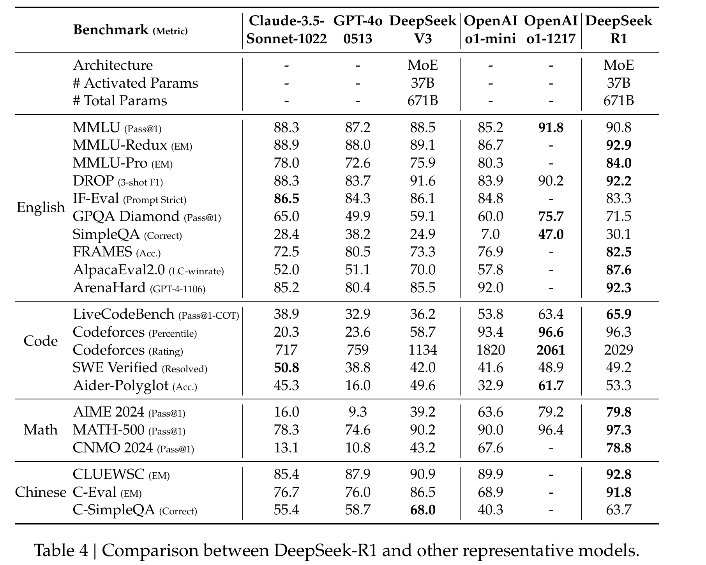
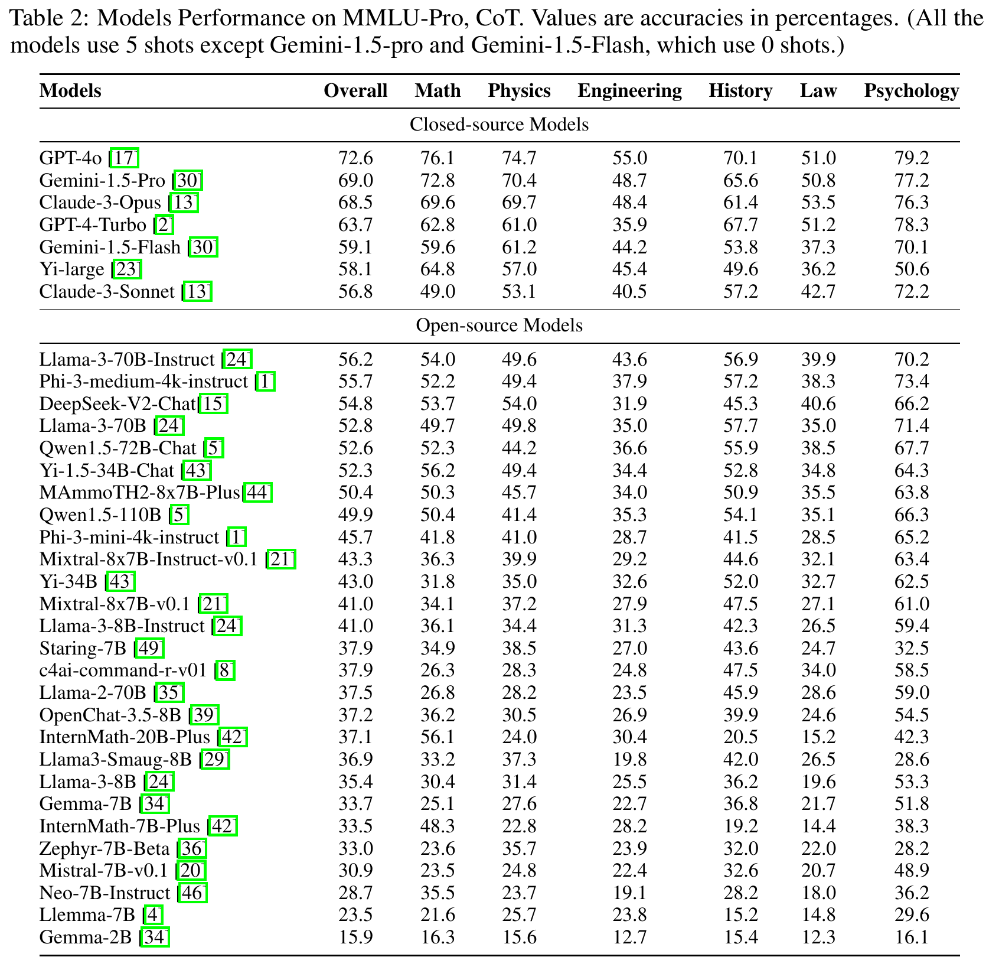
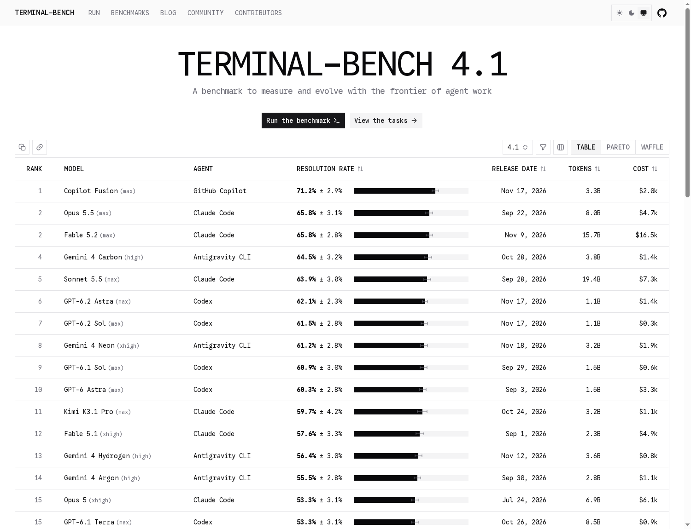
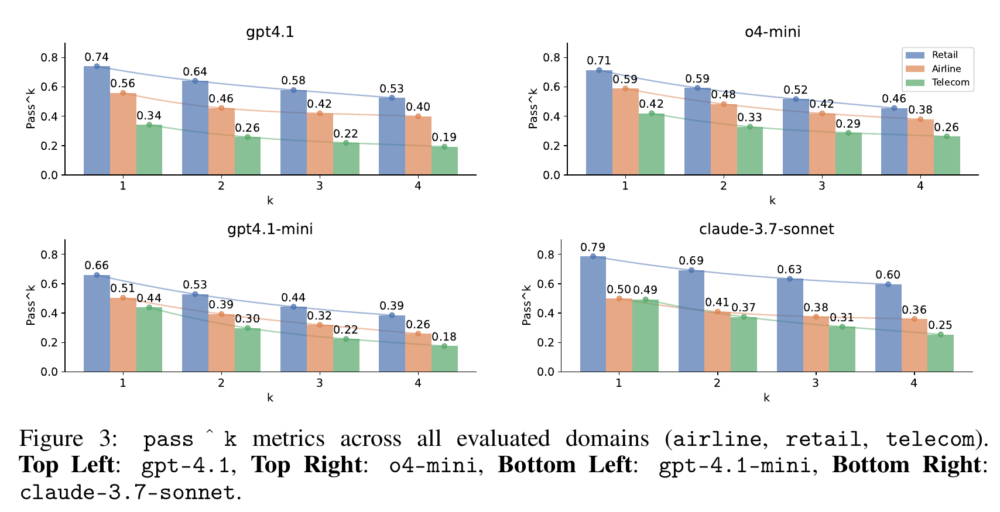
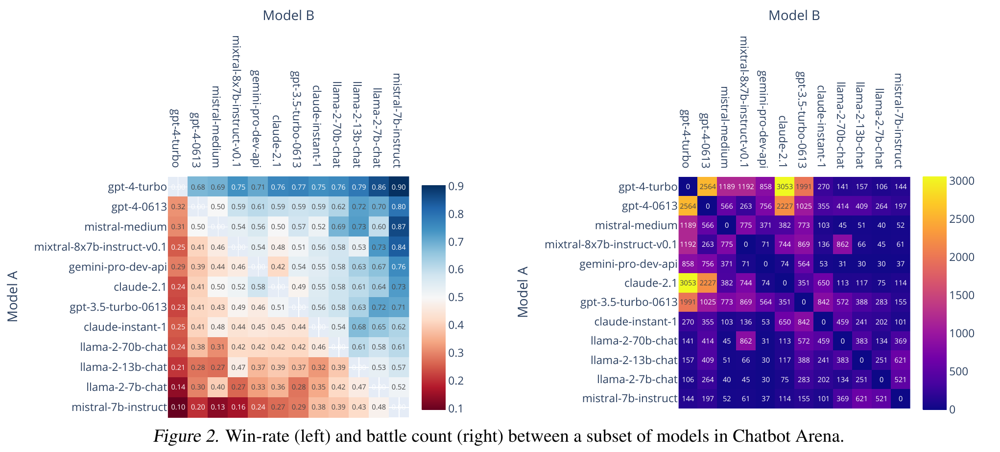

# 第 12 章 榜单

新模型发布时，厂商通常会给出一张成绩表。表头可能是 MMLU-Pro，GPQA Diamond，AIME，HLE，SWE-bench，Terminal-Bench，表格里则排列着百分数，柱状图和加粗的最高分。我们很容易看出哪一格更高，却未必知道模型完成了什么任务。数学题做对了九成，与软件缺陷修好了九成，背后需要的能力和评测过程都有很大差别；同样一个模型，如果可以搜索网页，运行代码，或者反复尝试，成绩还会继续变化。

要读懂这些表格，我们需要沿着一个分数往回看：评测者给了模型什么输入，模型可以使用哪些工具，最后由谁检查什么结果。理解这个过程之后，榜单中的缩写才会与具体能力对应起来，分数之间也才有比较的依据。我们还会发现，有些榜单比较单次回答，有些比较包含工具和运行程序的整个系统，还有些记录用户对两份回答的偏好，它们采用的标尺并不相同。

## 12.1 成绩表

我们先区分基准与榜单。评测者准备一组任务，规定输入，运行方式和评分规则，就建立了一个评测基准，通常称为 benchmark。不同团队按照这套规则提交结果，组织者再把结果排列出来，就形成了 leaderboard。一个基准可以同时存在官方榜单，独立复测和厂商自测，也可以因为运行方式不同而分成多个榜单。看到相同的基准名称时，我们还需要继续核对结果来自哪里。

一张模型发布表往往把不同基准放在不同列。MMLU-Pro 的百分数通常表示选择题准确率，SWE-bench 的百分数表示通过规定检查的任务比例，而 Arena 的一千多分来自比较结果拟合的相对评分。它们都能帮助我们观察能力，但分母和计算过程不同。我们不能把这些数字直接相加，也不能因为两个基准都采用百分数，就认为分数相近代表难度或能力相近。

DeepSeek-R1 的原始技术报告提供了一张完整的成绩表。我们可以先沿着一行比较不同模型，再沿着一列观察同一个模型处理不同任务的表现。行名括号里的小字也要一起看，因为它决定数字怎样解释。

图 12-1 DeepSeek-R1 原始技术报告中的综合评测。来源：DeepSeek-AI，2025 年，Table 4。

在 DeepSeek-R1 这一列中，AIME 2024 的 79.8 使用 pass@1，SWE Verified 的 49.2 使用 Resolved，而 Codeforces 的 96.3 使用 Percentile。前两项分别检查单次回答和代码任务的成功比例，Percentile 则描述按报告评测方式换算的相对参赛者位置。因而，96.3 的百分位不能理解为做对了 96.3% 的代码题，旁边的 Rating 2029 也采用另一套等级分标尺。

同一张表还出现 EM，F1 和 LC-winrate。EM 是 Exact Match，检查提取或规范化后的答案是否与参考答案一致；F1 综合考虑精确率与召回率，阅读理解任务常根据答案 token 的重合程度计算；LC-winrate 表示控制回答长度因素后的比较胜率。IF-Eval 后的 Prompt Strict 则说明检查整份回答是否满足严格的指令约束。我们先理解这些评分方式，再比较对应行里的模型，才知道每一处优势具体发生在哪里。

常见栏目可以先按下面的方式理解。表中写的是基本任务形式，实际比较时仍需要查看具体版本和配置。

| 栏目 | 模型实际要做的事 | 常见成绩 |
|---|---|---|
| MMLU-Pro | 阅读不同学科的题目并选择答案 | 准确率 |
| GPQA Diamond | 回答高难度科学选择题 | 准确率 |
| AIME | 解数学竞赛题并给出最终整数答案 | 单次正确率或多次运行的平均正确率 |
| HLE / HLE-Diamond | 回答跨学科专家题目，部分题目带图像 | 答案正确率 |
| SWE-bench | 阅读仓库和问题描述，提交代码修改 | 通过测试的任务比例 |
| Terminal-Bench | 在终端环境中完成一项工作 | 任务解决率 |
| BFCL | 按工具定义选择函数并完成调用 | 各类调用任务的准确率 |
| Arena | 对同一任务产生回答，接受用户比较 | 根据偏好拟合的相对评分 |

除了表头，我们还要看模型名称旁边的小字。base 和 instruct 可能区分预训练模型与指令模型，high，xhigh，max 等标记可能表示不同推理强度，with tools 或 no tools 则说明是否允许外部工具。这些标记会改变实际运行方式。一个系列的模型名称相同，也可能对应不同快照，不同上下文长度和不同的推理预算，因此完整的模型条目应当连同这些配置一起阅读。

表格脚注还经常说明 0-shot，5-shot，CoT，pass@1，pass@k 或 avg@k。0-shot 表示提示中没有提供示范，5-shot 表示提供了五个示范；CoT 通常表示允许或要求模型在作答过程中进行多步推理。pass@1 观察单次尝试的成功率，pass@k 观察多份候选中至少一份成功的机会，而 avg@k 通常是多次单次运行成绩的平均值，具体仍以该表的定义为准。它们可能同时出现在一张图中，阅读时要先确认每个数字采用了哪一种口径。

## 12.2 知识与推理

MMLU 一类基准把不同学科的问题组织成选择题。模型读入题干和选项，输出一个选项，评测程序提取选项标记，再与标准答案比较。这样的流程成本较低，容易重复，也便于按学科分析。我们可以从成绩中观察模型对已有知识和部分推理任务的处理能力，但最终检查的是选择结果。模型可能没有给出解释，也可能解释中存在错误，只要最后选中了标准选项，基础准确率仍然会记为成功。

MMLU-Pro 在原有路线中增加了难度，包含一万两千余道题，覆盖十四类学科，并把选项数量扩展到最多十个。选项增多以后，随机猜测的基础命中率会降低，模型也需要区分更多相近答案。读取 MMLU-Pro 成绩时，我们还需要看是否提供了示范，是否允许生成推理过程，以及怎样从输出中提取答案。如果一个实现读取最后出现的字母，另一个实现读取指定答案字段，那么格式不规范的回答就可能得到不同评分。

图 12-2 MMLU-Pro 的总体与分学科成绩。来源：Wang 等，NeurIPS 2024，Table 2。表格上方保留了 CoT 和示范数量的说明。

在 GPT-4o 这一行，Overall 为 72.6，Law 为 51.0，Psychology 为 79.2。总体成绩把多个学科汇总起来，具体学科的表现仍有明显差别。表中只展示六个代表性学科，Overall 则对应完整评测，所以不能对可见的六列取平均来复算总分。表格说明还指出，多数模型采用 5-shot，两个 Gemini 模型采用 0-shot，并且使用 CoT。模型看到了多少示范，同样属于解释成绩所需的信息。

不同学科的汇总方式也会影响总分。我们可以把所有题目的对错加在一起，计算总体准确率；也可以先分别计算各学科准确率，再对学科取平均。前一种方式让题目较多的学科占据更大权重，后一种方式让每个学科拥有相同权重。因此，看到“平均分”时，需要知道评测者究竟在平均什么。如果我们关心模型处理法律问题的能力，就应继续查看法律相关题目的成绩，而不能只依赖覆盖多个学科的总分。

GPQA 面向更难的科学知识与推理，常见的 GPQA Diamond 是其中经过进一步筛选的 198 道题，主要涉及物理，化学和生物。模型需要从选项中区分专业上相近的答案，所以它比普通知识问答更容易暴露概念理解和推导中的问题。另一方面，198 道题的规模也意味着，每多做对一道题，准确率就提高约 0.51 个百分点。两个模型相差一两个百分点时，可能只对应几道题，我们需要结合重复运行和逐题结果判断差异。

数学榜单常出现 AIME。AIME 的答案是规定范围内的整数，程序容易检查最终结果，因此它很适合观察模型能否通过推导得到正确答案。AIME I 与 AIME II 各有十五题，报告有时分别列出，也有时合并为三十题。阅读时既要看年份，也要看采用哪一套题。AIME 2025 与 AIME 2026 使用不同问题，一次尝试与每题多次采样也会得到不同含义的成绩。

这里尤其容易混淆“平均正确率”与“多次尝试至少成功一次”。假设评测者让模型对同一道题独立回答四次，其中两次正确，那么这道题对多次单次尝试的平均正确率贡献为 50%；如果评测采用 pass@4，它则已经满足“至少一次正确”的条件。前者帮助我们估计单次采样的表现，后者观察重复生成找到解答的机会。厂商若只写一个 95%，没有说明采样和聚合方式，我们就还缺少解释这个数字所需的信息。

数学评测还要区分最终答案题与证明题。最终整数正确，能够说明模型完成了该题规定的输出要求，但我们如果希望判断一段证明是否成立，就需要检查推导是否覆盖全部条件。有些评测由专家或模型评审证明，有些则要求生成 Lean 等证明系统能够检查的形式化证明。MathArena 在 2026 年已经包含多种评测形式，其中 ArXivLean 的 2026 年 9 月版本要求模型证明或否定给定猜想，并以固定的形式化陈述检查提交。读取这类成绩时，我们既要看证明检查是否通过，也要看模型是否始终在证明原来的命题。

难度更高的数学题还包括 FrontierMath。它按照难度区分题目，其中 Tier 4 面向研究级数学。这里的版本信息尤其值得注意：官方在 2026 年 6 月 12 日发布了 v2，修正了题目中的错误。因此，引用旧版成绩时，需要保留相应版本，不能把新版模型的成绩直接放进旧版曲线。MathArena 的竞赛目录同样已经把 AIME 2026 等部分旧项目标为停止更新，并提供 SmallMath 分级题集等新项目。题目较新与榜单仍在持续维护，是两个需要分别核对的条件。

HLE，也就是 Humanity's Last Exam，进一步把问题范围扩展到多个专家学科。它包含需要直接生成答案的题目，部分题目还要求读取图像。相较于选择题，模型在开放作答时失去了选项提示，评测者也需要处理等价表达。对于可以规范化的数值和符号，可以由程序比较；对于更复杂的短答案，则可能使用答案匹配模型判断其是否与参考答案一致。因此，我们读取 HLE 成绩时，还需要知道是否允许搜索和代码工具，以及评分器采用什么方式确认答案。

2026 年 9 月 22 日公布的 HLE-Diamond 对原题集合进行了清理，保留一千道题，分成五百道推理题与五百道知识题。这个名称与 GPQA Diamond 相似，但它们属于不同的基准。HLE-Diamond 的工具版本与闭卷版本也要分开阅读：闭卷表现更直接地依赖模型已有知识和内部推理，允许搜索与代码以后，系统还可以检索资料，验证计算并反复修正。两种成绩都提供信息，只是它们观察的能力范围已经发生变化。

## 12.3 代码与执行

代码榜单首先要区分任务规模。HumanEval 要求模型根据函数说明补全实现，再运行测试判断功能是否正确。这类任务适合检查局部代码生成，评测程序也容易大规模运行。但是，修复真实项目通常还需要找到相关文件，理解接口，安装依赖，重现错误，并判断修改是否影响其他行为。为了观察这些能力，仓库级基准会把整个项目和问题描述交给模型。

LiveCodeBench 延续了通过执行检查代码的方式，同时持续收集竞赛问题，并为题目记录发布时间。评测者可以选择某个时间范围的问题，再与模型训练时间作比较。它的价值在于提供了时间维度，让我们有机会观察模型在较新问题上的表现。读取成绩时，需要同时记录题目时间窗口和模型版本；如果一个结果采用较早的题目，另一个结果采用较新的题目，即使都叫 LiveCodeBench，也不能只比较两个百分数。

SWE-bench 把任务改成软件仓库中的真实问题。模型拿到指定版本的代码和问题描述，提交一份修改，评测程序再把修改应用到干净环境中运行测试。评分时既要检查与目标问题相关的测试是否通过，也要检查原本通过的相关测试是否因修改而失败。因此，榜单中的 resolved 通常表示任务满足了规定的测试要求，百分数的分母则是这一版本包含的任务数。

SWE-bench 有多个分支。Verified 是经过人工筛选的五百道任务，Lite 包含三百道任务，Multilingual 扩展到多种编程语言，Multimodal 则包含需要处理视觉信息的问题。Scale 提出的 SWE-bench Pro 属于另一组任务与评测设计。我们需要把这些完整名称保留在成绩表中，否则同一个“SWE-bench 分数”可能指向难度和内容都不同的测试集。

在仓库任务中，运行程序也直接影响成绩。它决定模型怎样搜索文件，如何读取长输出，什么时候运行测试，以及上下文不足时保留哪些内容。SWE-bench 官方 Verified 页面目前把 Bash Only 作为默认视图，在同一个 mini-SWE-agent 环境中比较模型。这样的设置能够减少运行程序差异，帮助我们观察更接近模型本身的变化。若某条成绩使用了定制智能体，多次生成和额外选择器，我们就应把它作为完整系统结果阅读，并且核对相应预算。

SWE-bench Pro V2 提供了一个理解评测协议的实际例子。Scale 在 2026 年 9 月 22 日公布这一版本，公开部分由原来的 731 道任务调整为 642 道，并修正了部分说明与测试之间的矛盾。新的协议还限制了智能体阶段的网络访问，并把提交的修改放到干净镜像中重新评分。这些修改分别处理题目是否成立，模型能否从外部获得现成补丁，以及工作目录中的状态是否影响评分等问题。我们在比较 V1 与 V2 时，需要承认评测条件已经变化，不能把分数差全部归因于模型进步。

另一项容易误读的指标是部分测试通过率。一个任务可能包含上百项测试，模型通过其中绝大多数，却仍然遗漏一个会影响核心行为的条件。如果榜单按“整个任务解决”计分，这道题就仍然失败；如果榜单报告平均测试通过率，它又可能得到很高的成绩。两种指标能够分别反映整体可交付程度和局部完成程度，但阅读时必须知道每一列检查什么。

ProgramBench 很清楚地展示了这种差别。它要求智能体根据编译后的程序和文档，从头实现能够复现其行为的代码库。官方页面标示的 2026 年 10 月 22 日版本包含两百道任务，其中 Resolved 表示通过全部隐藏行为测试，Almost 表示至少通过 95% 的行为测试。在这份结果中，Claude Opus 5.5（xhigh），配合 mini-SWE-agent，Resolved 为 18.5%，Almost 为 70.5%。两个数字来自同一个系统，只因完成标准不同就相差很大。模型已经实现了许多行为，与它已经完整解决了多数任务之间，还需要逐项检查剩余条件。

Terminal-Bench 则把评测范围扩展到终端中的完整工作。模型需要根据任务要求操作环境，可能涉及编程，依赖处理，数据处理或系统配置，随后由检查程序判断结果。榜单通常把模型和 Agent 分成两列，因为基础模型与执行程序共同决定任务表现。图 12-3 保留了官方榜单的表头，模型配置和成绩，我们可以直接对照这些栏目理解一次完整的执行评测。

图 12-3 Terminal-Bench 4.1 官方榜单。截图日期：2026 年 11 月 27 日。

先看 Model 与 Agent 两列，同一个模型系列可能通过不同程序执行任务，括号中的 max 或 high 又标明了推理配置。Resolution Rate 是任务解决率，其旁边的加减范围对应页面公布的 95% 置信区间。Release Date 列标注条目的发布信息，Tokens 和 Cost 则记录相应评测的资源投入。我们需要按页面说明理解这些费用，不能把整次评测的 Cost 直接当成一个普通请求的价格。

这里的加减范围描述估计的不确定性。我们可以据此知道，页面显示到小数点后一位，并不意味着实验已经精确到十分之一个百分点。两个 65.8% 也不表示它们逐题表现相同，它们可能解决了不同任务，并且消耗了不同资源。继续比较时，需要查看逐题成绩，重复次数和成本，而表中 Model 与 Agent 两列应始终一起保留。

## 12.4 工具与交互

工具调用榜单观察的是模型能否根据用户要求选择正确接口，并构造有效参数。最简单的任务会提供若干函数定义，让模型生成一次调用。检查程序可以解析调用结构，再比较函数名称和参数；参数次序或空白不同，未必改变调用含义，因此有些评测会使用抽象语法树，也就是 AST，检查结构。看到 AST accuracy 时，我们应当把它理解为某种结构化调用检查的准确率，并继续查看该基准如何处理默认参数，等价值和多种有效答案。

BFCL，也就是 Berkeley Function-Calling Leaderboard，沿着这条路线逐步扩展。它既包含单次调用，也包含多个调用和多轮交互，并检查在没有合适工具时模型能否避免编造调用。官方当前页面使用 BFCL V4，进一步加入了搜索，记忆和其他智能体相关场景。其总准确率由不同子类别汇总而来，所以一个高总分需要结合分项阅读：模型可能善于从完整参数生成调用，却不善于处理缺少参数的对话，也可能在单轮准确，多轮过程中却丢失状态。

调用结构正确之后，我们还需要知道工作是否完成。工具可以接受一组格式合法的参数，但模型如果识别错了用户指向的实体，最终就仍然修改了错误对象。交互式基准因此会让模型与用户模拟器对话，并把操作放进可检查的业务环境。模型既需要获取信息，也需要理解业务规则，还要根据工具返回决定下一步，最后由环境状态和任务约定共同评分。

τ-bench 系列就采用了这样的设计。模型在规定的业务环境中与模拟用户交互，调用工具，并遵守领域规则。τ²-bench 的电信任务进一步允许用户操作自己一侧的环境，模型需要说明步骤并协调双方行动。τ³-bench 又加入知识检索等任务，银行知识场景要求模型在文档中找到适用规则，再完成业务交互。这里的困难已经从“函数怎样填写”延伸到“当前应该做什么，以及怎样确认操作已经满足要求”。

截至本章核对日期，官方仓库已经采用 τ-bench 2.0 的版本名称，加入六种语言和相应语音评测。这个 2.0 版本号与此前论文名称中的 τ² 属于不同命名方式，阅读时需要根据完整版本确认任务。官方还明确说明，2.0 与 1.x 的英语运行在任务，提示和评审配置上存在变化，成绩不能直接横向比较。因此，成绩表写 τ²-bench，τ³-bench 或 τ-bench 2.0 时，我们都需要继续确认数据发布版本和具体业务域。

这类榜单经常报告 pass^k。它要求同一个任务在 \(k\) 次运行中每次都成功，用来观察交互系统的稳定性。与之相比，pass@k 只要求多份候选中至少一份成功。两个符号看起来相近，要求却差别很大：前者适合观察反复使用时是否可靠，后者适合观察多次尝试能否找到答案。如果榜单只写 pass 1，我们还应确认它指单次成功率，还是某个特定评测脚本中的字段。

图 12-4 τ²-bench 的重复成功率。来源：Barres 等，2025 年，Figure 3。横轴为要求全部成功的运行次数，纵轴为相应任务比例，三种颜色分别表示零售，航空和电信任务。

左上角 GPT-4.1 的零售任务结果从 pass^1 的 0.74 降到 pass^4 的 0.53，电信任务则从 0.34 降到 0.19。随着横轴增大，同一道任务需要在更多次独立运行中全部成功，检查条件也越来越严格，所以曲线下降。我们可以先比较单次成功率，再观察要求重复成功时还剩下多少任务，以此理解一个系统在反复使用中的稳定程度。

搜索任务又增加了证据获取问题。BrowseComp 要求智能体找到难以直接检索的事实，通常需要多步搜索与核对，最后给出便于验证的短答案。读取成绩时，我们需要看搜索工具和总预算：一次关键词查询与允许反复检索，阅读多份页面的系统，获得信息的机会不同。它主要检查最终答案是否正确，而如果我们关心一份完整调研报告，还需要补充引用是否支持结论，材料是否覆盖问题，以及报告是否遗漏重要条件等检查。

网页和桌面操作则进一步要求模型把判断变成界面动作。WebArena 把任务放进可运行的网站环境，OSWorld 让模型在真实桌面应用中执行操作。模型可能需要根据页面结构或截图找到控件，输入内容，并检查修改后的状态。因此，榜单中的动作空间非常重要：只允许根据截图点击，与允许读取网页结构和调用脚本，会给模型不同信息。OSWorld-Verified 等修订版本还修改过任务和检查规则，我们需要把环境版本，最大步数和输入方式一起记录，才能解释成功率。

## 12.5 对话与偏好

有些任务可以检查对错，有些任务则需要判断哪份回答更合适。对同一个写作请求，两个模型可能都满足基本要求，但读者更喜欢其中一份的组织和表达。Arena 的对战榜单通过匿名比较收集这种偏好：用户向两个模型提出相同任务，阅读回答后选择更好的一份，也可以选择平局或两份都差。模型身份在投票后揭示，以减少名称本身对选择的影响。

如果所有模型都与相同对手进行了同样多的比较，我们可以直接观察成对胜率。但真实数据里，不同模型遇到的对手和比较次数往往不同。为了把这些比较放进统一标尺，Arena 使用 Bradley–Terry 回归拟合模型强度。我们可以把它的基本关系写成：

\[
P(A\succ B)=\sigma(s_A-s_B)
\]

这里 \(s_A\) 和 \(s_B\) 是根据投票拟合的强度，\(\sigma\) 是 sigmoid 函数。两者相同时，模型预测 A 获胜的概率为 50%；分差越大，预测的获胜概率越高。评测者通过大量模型之间的比较，寻找一组能够解释观察结果的强度，再将其换算成页面上的相对评分。这类分数经常被称为 Elo 或 Elo-like rating，与棋类比赛的相对评级有联系，具体换算仍以平台方法为准。因此，一千五百分表达的是这套比较模型中的位置，它不表示做对了一千五百道题，也不能直接当作准确率。

如果页面另外列出 Win Rate，我们还需要查看它相对于谁计算。有些页面展示模型对某个固定基线的胜率，有些汇总它与多个对手的比较，并可能把平局按半次胜利计入。面对较弱对手取得的高胜率，与面对较强对手取得的较低胜率，需要结合对手分布解释。相对评级正是通过共同的比较关系处理这类差异，而某一对模型的胜率仍然适合回答两者之间的具体比较问题。

图 12-5 Chatbot Arena 原论文中的成对胜率与对战数量。来源：Chiang 等，2024 年，Figure 2。图中记录的是论文当时的数据。

左图的每个单元格对应两个模型之间的胜率，右图在相同位置记录对战数量。我们先在一行选定模型，再沿列找到它的比较对象，就能把胜率与实际比较次数对应起来。不同单元格的样本量并不相同，因此两个看起来相近的胜率，估计精度也可能不同。对角线对应模型与自身的位置，不参与这里的有效比较；图中填入的零也不表示模型能力为零。

从这两幅图回到相对评分，我们就能理解评测者为什么需要把多组比较一起拟合。一个模型的分数利用了它与不同对手之间的关系，单独某个单元格则只描述两者之间的比较。继续读取近期榜单时，我们也需要保留模型配置，评分日期和区间，避免把不同时间或不同评分体系中的一千多分直接放在一起比较。

偏好数据还会受到回答形式的影响。更长的回答可能看起来更充分，更多标题可能让结构更醒目，但这些特征在不同任务中的价值不同。Arena 的方法允许在统计模型中加入长度和风格等特征，以观察控制这些因素之后的结果。阅读榜单时，我们需要确认页面显示的是哪种统计视图，同时查看自己的使用场景是否接近该类投票任务。面向日常聊天的总体偏好，可以帮助我们选择聊天模型，但不能独立说明它处理代码仓库或业务操作的成功率。

Arena 当前还包含 Agent Arena 等不同榜单。2026 年 11 月 18 日，官方更新了智能体榜单，提供 Agent Arena Index，以及工作，代码，对话，任务结果，工具使用和可引导性等分项指数。它们根据交互过程中的多种信号汇总，评分方法与匿名回答对战有所区别。我们看到 Arena 这个名字时，首先仍要确认自己正在读文本偏好，搜索，网页开发，还是智能体执行相关页面，然后再解释相应分数。

## 12.6 综合指数

当评测项目越来越多时，平台会把多个基准汇总成综合指数。这样可以减少单项波动的影响，也便于观察模型的总体变化，但总分取决于选了哪些任务，以及各项占多少权重。我们可以把一般形式写成：

\[
I=\sum_{j=1}^{m}w_j\,g_j(s_j),
\qquad
\sum_{j=1}^{m}w_j=1
\]

这里 \(s_j\) 是第 \(j\) 项原始成绩，\(g_j\) 表示平台对这项成绩采用的换算方式，\(w_j\) 是权重。有些指标越高越好，有些指标需要先改变方向；有些采用准确率，有些采用相对评分，汇总前也需要统一处理。因此，读取指数时需要同时理解任务组成，换算方式和权重，直接平均原始数字通常没有明确意义。

Artificial Analysis 的 Intelligence Index 是常见的综合指标。截至 2026 年 11 月 27 日，其方法页采用 **v5.0.2**，纳入九项评测，并按四个能力类别汇总，每类占 25%：

| 类别 | 当前纳入的评测 |
|---|---|
| 知识工作 | AA-Briefcase v1.1，AutomationBench-AA，GDP.pdf |
| 编程 | FrontierCode-AA 2.0，Terminal-Bench 4.1 |
| 科学 | CritPt v2 的困难子集，Terminal-Bench-Science 0.1 |
| 综合知识 | AA-Omniscience v1.1，HLE-Diamond |

类别权重相同，类别内部各项的权重仍然不同。我们从这组任务也能看出，它已经包含相当多的工具使用和工作完成要求。早期常见的 MMLU-Pro，AIME 2025 和 GPQA Diamond，目前在该方法页中归入历史评测。因此，阅读旧发布图中的 Intelligence Index 时，需要同时保留指数版本。某个模型跨版本分数发生变化，可能既包含模型差异，也包含题目组成和汇总方式变化。

综合指数中的知识工作值得具体理解。AA-Briefcase v1.1 提供真实工作形式的材料，要求模型产出电子表格，演示文稿或备忘录，并分别检查任务要求，分析质量和呈现质量。它包含四个项目中的九十一项任务；虽然材料描述连续的工作背景，当前评测仍让每项任务独立运行，没有沿用模型上一项任务的提交。这个条件决定了我们应怎样理解“长周期工作”：评测覆盖了相应工作内容，但没有直接测试同一个智能体持续数周保存状态的全部过程。

AutomationBench-AA 则让智能体通过 REST API 在模拟的软件服务中完成工作流程，再根据最终状态评分。它使用来自 Zapier 的 657 项任务，覆盖四十个模拟应用环境，并同时检查业务规则是否被违反。这样的任务与选择题采用不同的输入和检查方式，也让综合指数能够反映一部分实际操作能力。我们若主要关心软件服务中的自动化，就可以继续查看这一分项，分析模型在哪些流程上成功，而无需仅凭总指数作判断。

综合榜单通常还把成本和速度放在分数旁边。下表摘录了 2026 年 11 月 27 日读取的 Artificial Analysis 当前模型表。模型配置中的 Default Fallback 保留页面原标记，费用和耗时也采用页面公布的口径：

| 模型配置 | Intelligence Index | Cost per Task，美元 | Time per Task，分钟 |
|---|---:|---:|---:|
| Claude Fable 5.2，Max，Default Fallback | 65 | 26.54 | 40.3 |
| GPT-6.2 Astra，Max | 62 | 4.00 | 16.1 |
| Gemini 4 Neon，Xhigh | 62 | 6.44 | 27.7 |

这里的 65 是该版本指数，不能理解为整体准确率 65%。费用和耗时对应平台规定的评测工作，也不能直接用作普通聊天请求的单价和响应时间。这个表更适合帮助我们观察同一平台内质量与投入的关系，再决定哪些模型值得继续测试。若准备处理自己的业务任务，我们还需要按实际输入长度，缓存使用，推理配置和工具流程重新测量。

其他榜单可能按每百万 token 标注输入和输出价格，或用 tokens/s 标注生成速度。价格的单位描述服务怎样收费，实际任务费用还取决于读入和生成了多少 token，以及缓存和工具的使用情况。生成速度通常描述某个测量阶段的输出速率，而 TTFT，即 Time to First Token，描述收到第一个 token 前的等待时间。对于推理模型，内部推理 token 与用户可见的回答 token 还可能分开统计，因此遇到 Time to First Answer Token 时，应按“第一个回答 token”理解，不能与所有平台的 TTFT 直接混用。

完整任务耗时又包含更多过程。智能体可能在首次回答前等待工具，也可能在多轮生成和执行之间反复切换，因此它与持续输出时的 tokens/s 不能直接换算。若页面给出 P50 和 P95，前者表示一半样本的耗时不超过该值，后者表示约 95% 的样本不超过该值。我们既可以用 P50 观察典型等待，也可以用 P95 观察较慢请求，随后再判断这些测量条件是否接近自己的服务。

榜单有时会把这些结果画成帕累托前沿。我们可以先考虑分数越高越好，成本越低越好的情况：若另一个模型分数更高，并且费用更低，那么当前模型在这两个维度上就没有优势；把没有被其他条目同时超过的点连接起来，就能看到可供取舍的范围。如果加入延迟，部署条件或某项能力最低要求，可选择的范围还会继续变化。因此，这类图适合帮助我们根据约束缩小候选，而总分最高的条目只对应其中一种选择。

## 12.7 专项能力

综合榜单覆盖的任务终究有限。我们如果准备处理长文档，首先需要区分上下文容量与有效使用能力。模型声明支持一百万 token，说明接口或架构允许接收相应长度的输入；能否在这些内容中找到关键事实，跨段落推导，并保持后续回答准确，则需要专门评测。榜单把 Context Window 列在模型旁边时，这一列通常属于模型规格，不能直接当作长文本理解成绩。

最直观的测试是在长文本中插入一条信息，再要求模型把它找出来，通常称为大海捞针测试。我们可以改变信息位置和干扰文本长度，观察模型什么时候开始遗漏。但实际文档任务还可能要求连接多个位置的线索，所以 RULER 进一步加入多条信息检索，变量追踪和聚合等任务。读取这类成绩时，需要看曲线在不同长度和任务类型上的变化，而单个长度上的平均分只能描述其中一个设置。

LongBench v2 更接近真实材料的综合理解，包含 503 道选择题，覆盖单文档，多文档，长对话，代码仓库和结构化数据等场景。它的原始长度说明采用词数，范围从八千词到两百万词，不能直接把这个范围当成同样数量的 token。我们读取分项时，可以同时查看输入长度，任务类别，以及评测是否截断材料。若模型上下文装不下原文，系统采用摘要或检索之后得到的成绩，就还包含相应预处理的影响。

指令遵循又是另一种能力。模型可能知道正确答案，却没有遵守输出格式或其他明确限制。IFEval 把这些限制写成程序能够检查的要求，例如规定长度，必须包含的词语或特定格式。评分可以按单条约束统计，也可以要求一份回答满足全部约束。因此，instruction-level accuracy 与 prompt-level accuracy 的分母不同：前者统计通过了多少条要求，后者统计多少份回答整体合格。一份回答只违反一项条件，前者可能仍有较高得分，后者则可能判为失败。

IFEval 的 strict 与 loose 也需要结合检查实现理解。strict 按原有检查流程判断，loose 会在规定范围内处理部分格式干扰之后再检查，目的是减少检查器对某些外观差异的敏感性。它们都是约定好的程序规则，不能把 loose 泛化成“意思差不多就通过”。IFBench 继续加入新的约束和组合，用来观察模型能否把学到的指令遵循方式推广到未见要求。对经过 SFT 或偏好训练的模型，这些分项能够帮助我们判断改善发生在知识回答，还是发生在精确执行要求上。

中文能力也需要专门观察。CMMLU 覆盖六十七个主题，并包含中国语境下的知识和常识问题；C-Eval 也是常见的中文学科评测。它们能够检查中文题目的理解和知识回答，但中文写作还包含表达是否自然，指代是否清楚，以及模型是否遵守长度和风格要求。我们可以把中文知识基准与中文生成任务结合起来看，并确认综合榜单中的中文成绩采用什么题目和评审方式。

SuperCLUE 等中文综合榜单提供了另一组观察结果。官方页面截至核对时已经列出 2026 年 11 月测评，我们读取时应保留对应期次，并核对该期收录哪些模型，使用哪些能力分项。英语综合指数与中文综合榜单出现不同排序，可能与任务语言，题目分布和权重有关。对中文应用而言，继续查看中文任务分项，通常比把英语总分直接当作中文能力更有依据。

对齐相关榜单还会检查模型怎样拒绝有问题的请求，以及能否在正常任务中继续提供帮助。HarmBench 提供有害行为与攻击评测，用来观察模型在攻击下是否生成相应内容。我们需要同时知道攻击方法，尝试次数和判断规则，并补充正常请求中的误拒情况。只比较拒绝比例，会把合理拒绝与过度拒绝混在一起，无法说明模型是否改善了实际使用中的判断。

工具智能体还会面对来自网页，邮件或文件中的恶意指令。AgentDojo 把这类内容放进工具返回，让智能体继续处理原来的用户任务，并分别观察正常工作是否完成，以及攻击是否成功。这里需要同时阅读任务成功率与攻击成功率，因为一个系统可能通过拒绝读取全部外部材料来降低攻击成功率，却也因此无法完成工作。两项结果放在一起，才能帮助我们判断防护措施改变了什么。

## 12.8 比较成绩

读一张新模型成绩表时，我们可以先从最关心的一列开始，把它对应的任务和评分过程理解清楚。若这一列是 GPQA Diamond，就确认它采用 198 道题中的哪种运行协议，是否闭卷，以及成绩来自单次还是重复尝试；若这一列是 SWE-bench，就继续确认任务分支，运行程序和测试条件。等到这些信息能够对应起来，再看几个模型之间的分数差，比较才有明确对象。

随后，我们需要判断这些数字是否真的在相同条件下取得。厂商发布表可能同时包含自己的复测成绩和从其他报告引用的成绩，脚注往往会说明来源。自测结果，官方提交和独立复现都可以提供信息，但它们的提示，预算和工具未必一致。如果同一张图把这些结果放在一起，我们应保留各自配置，避免把图形上的并列位置误认为实验条件已经统一。

分数差也要结合样本量和不确定性。小题集上的一个百分点可能只对应一两道题，而带有随机交互的智能体任务还会受到环境和采样影响。我们可以优先查看区间和重复运行，再分析关键分项。两个模型总分接近时，任务分布和成本通常比小数点后的名次更有帮助；一个模型整体领先时，我们也可以继续确认它是否满足目标任务中的最低要求。

如果准备通过 SFT，蒸馏或偏好训练修改模型，公开基准还可以帮助我们检查能力变化。我们可以在训练前保存基线，再使用相同协议评测训练后的版本，观察哪些分项提高，哪些分项退化。如果训练数据已经包含某项公开基准或其近重复题，我们就需要另外保留未参与训练的任务，用来判断变化能否推广。对于包含工具的系统，也应固定运行程序，或者明确记录运行程序的修改。

最终，我们可以把公开榜单作为筛选候选的依据，再用自己的任务检查交付效果。榜单告诉我们一个系统在特定任务和预算下完成了多少工作，业务评测则继续检查它在实际材料，规则和运行条件中的表现。只要能够从分数追溯到题目，运行过程和检查标准，我们就能判断一项成绩能够支持什么选择，并据此安排后续实验。
